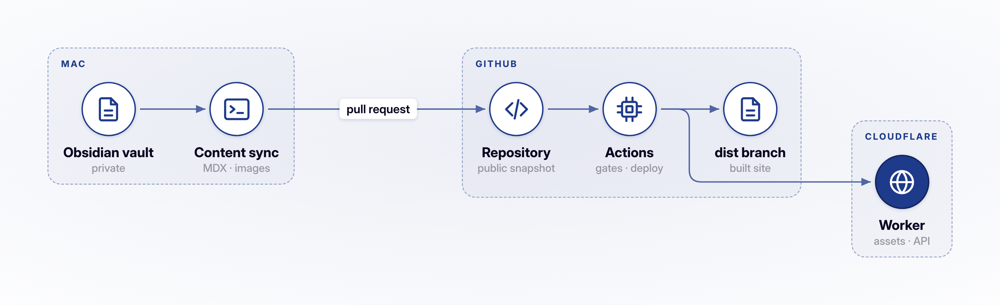
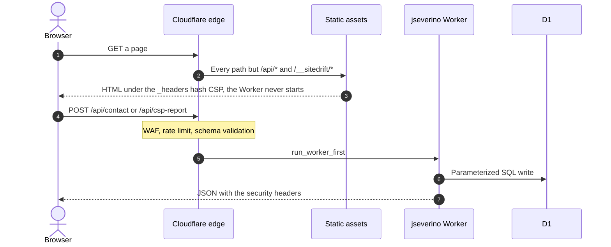

# Technical architecture

How `jseverino.com` is built: where data enters, what the build transforms, and what runs at Cloudflare's edge.

## 1. System shape

The site is one Astro program on the Cloudflare Workers adapter: every page is prerendered into a static asset, and a few on-demand routes run in the same Worker. GitHub Actions builds it once, gates that build, and deploys it as the `jseverino` Worker ([§14](#14-release-gate)).



<sup>Diagram source: [`docs/diagrams/system-shape.fig`](./diagrams/system-shape.fig),
pre-rendered with [`brand figure`](https://github.com/joeseverino/branding-engine).</sup>

The request-time execution and data boundary is at the edge:



Every HTML page is a prerendered asset the assets layer serves without starting the Worker ([Worker routing](./Cloudflare.md#worker-routing)). The only request-time code is the on-demand Astro routes:

- [`src/pages/api/contact.ts`](../src/pages/api/contact.ts) handles contact form submissions through the handler in [`src/lib/api/contact.ts`](../src/lib/api/contact.ts).
- [`src/pages/api/csp-report.ts`](../src/pages/api/csp-report.ts) receives CSP violation reports through [`src/lib/api/csp-report.ts`](../src/lib/api/csp-report.ts) and stores filtered records in D1.
- [`src/integrations/sitedrift-route.ts`](../src/integrations/sitedrift-route.ts) is the read-only preview-review proxy under `/__sitedrift/*`, injected as a route by [`sitedrift-preview.ts`](../src/integrations/sitedrift-preview.ts). With no generated sitedrift configuration, as in production, it returns `404`.

There is no public admin panel, user account system, comment system, upload endpoint, or origin application server. Measurements are in the [WordPress to Astro migration comparison](./WordPress-To-Astro-Migration.md#may-2026-migration-comparison).

## 2. Source of truth

The private Obsidian vault is the editorial source of truth. This repository is the sanitized public snapshot and build source; the build runs from the committed snapshot and needs no vault access. The synced files are [`src/content/pages/`](../src/content/pages/) and [`src/content/writeups/`](../src/content/writeups/), one `<slug>/index.mdx` per document with its image masters in `<slug>/images/`, and [`src/content/technology-groups.md`](../src/content/technology-groups.md).

Each schema has one versioned source. [`contracts/content.v1.json`](../contracts/content.v1.json) describes every page and writeup field: visibility, defaults, ownership, editability, and CLI flags. [`bin/sync-content-contract.ts`](../bin/sync-content-contract.ts) generates the typed Astro schema and the public contract projection the MCP and tools read from it. [`contracts/contact.v1.json`](../contracts/contact.v1.json) owns the contact request's fields, limits, formats, and runtime ceilings; the browser form, the Worker handler, and the API Shield OpenAPI document derive from it. `mise run checks:contracts` fails when any generated projection is stale.

### Portfolio software list

The Software tab of `/portfolio` is not vault-synced. Its repository facts (which repos, description, primary language, last push) come from the GitHub account's public repos, so a repo's GitHub description is its card's on the next snapshot:

- [`src/lib/github.ts`](../src/lib/github.ts) reads the committed snapshot [`src/data/github-repos.json`](../src/data/github-repos.json), so builds never call GitHub and need no token. `mise run snapshot:github` refreshes it after a description changes or a repo is added.
- [`src/data/package-registry.json`](../src/data/package-registry.json) is the matching snapshot of PyPI and npm versions and monthly downloads. `mise run snapshot:software` refreshes it after a package publishes, and writes nothing if any lookup fails.
- [`src/lib/software.config.ts`](../src/lib/software.config.ts) is the one hand-kept input: the skip list, featured set, order, writeup cross-links, and the package mappings GitHub cannot know. [`src/lib/software.ts`](../src/lib/software.ts) composes it with the snapshots.

Registry requests time out after five seconds, response bodies included. Content, GitHub, and software loaders share pending work through [`async-cache.ts`](../src/lib/async-cache.ts), and a failed load can be retried.

## 3. Sync pipeline

[`bin/sync-content.ts`](../bin/sync-content.ts) orchestrates the private-to-public sync. Source-specific parsing is [`bin/content-sync/source-adapters.ts`](../bin/content-sync/source-adapters.ts), public sanitization [`bin/content-sync/public-projection.ts`](../bin/content-sync/public-projection.ts), and the rest of [`bin/content-sync/`](../bin/content-sync/) holds asset references, image masters, document rows, education, prune, the compile check, and the one writer that records every output. The sync:

- reads published vault pages and writeups, and copies the vault's technology groups to [`src/content/technology-groups.md`](../src/content/technology-groups.md);
- carries only the frontmatter fields the contract marks public, so vault-only metadata drops by omission;
- writes each document as `<collection>/<slug>/index.mdx`, a writeup without the H1, lede, and leading image its page renders from frontmatter;
- refuses an asset path that resolves outside the source folder, and writes each referenced image's master beside its document ([§8](#8-image-pipeline));
- dates `last_reviewed` from the committed snapshot ([SEO, article dates](./SEO.md#article-dates));
- reports every file written or removed (`--report`), the exact set `site publish` commits.

`--check` (`site validate`) resolves the same references and the frontmatter contract and compiles every document with the site's renderer, writing nothing, so an MDX error or a refused block surfaces with its line before a build. A relative link outside `images/` would 404 on the site: `--check` reports it, and the sync stops on it for a published document and warns for a draft.

Masters are cached by source hash and encoder version under the cache root every checkout shares (`SITE_CACHE_DIR`, whose comment in `mise.toml` says what it holds). Each is written to a temporary name and renamed, so an interrupted sync leaves no partial file.

## 4. Content collections

Astro content collections are registered in [`src/content.config.ts`](../src/content.config.ts). Their field validators come from the committed generated module [`src/generated/content-schema.ts`](../src/generated/content-schema.ts), derived from [`contracts/content.v1.json`](../contracts/content.v1.json), which lists every field. To add or change a field, edit the contract beside the fields it resembles and run `mise run sync:contract`.

The committed snapshot holds no drafts (`mise run checks:drafts`). `site dev --drafts` syncs unpublished content into the gitignored `.cache/drafts` overlay and points the dev server at it through `SITE_CONTENT_ROOT`; the loaders render unpublished entries only under `astro dev`.

## 5. Markdown rendering

Documents are MDX, rendered by Astro 7's default Markdown processor, [Sätteri](https://satteri.bruits.org/): a Rust parser with plugins written in TypeScript against the standard mdast and hast trees. The site's plugins are in [`src/lib/markdown/`](../src/lib/markdown/), each a separate pass:

- [`guard.ts`](../src/lib/markdown/guard.ts) keeps content from being code. MDX would run `import`/`export` and `{…}` expressions at build time and treat raw HTML as JSX; the guard refuses all three, limits raw HTML to an allow-list of tags and string attributes, and refuses URL schemes other than http(s) and mailto, in button blocks too. A refusal fails the build with its line.
- [`literal.ts`](../src/lib/markdown/literal.ts) puts inline `:name` text directives back as the text they were parsed from, so a MAC address's `:1e` stays literal.
- [`blocks.ts`](../src/lib/markdown/blocks.ts) renders the container directives (`:::figure`, `:::table`, `:::button`, `:::buttons`, `:::center`, `:::hero`, `:::split`/`:::side`) to the site's markup, and the placeholders (`::featured-projects`, `::technology-cloud`, `::contact-form`) to elements a page maps to components, grouping the prose between them into runs.
- [`prose.ts`](../src/lib/markdown/prose.ts) reads image modifiers (``) and, in a writeup, turns a paragraph that is only a link into a button.
- [`markup.ts`](../src/lib/markdown/markup.ts) renders ` ```terminal ` fences, adds break opportunities after `.` and `:` in table cells, and wraps every table in a scrollable figure.

[`ContentBody.astro`](../src/components/content/ContentBody.astro) renders an entry with its component map: every Markdown image as [`Image.astro`](../src/components/Image.astro), each placeholder as its component, and each run of prose in the page's wrapper. The syntax is in the [Authoring Guide](./Authoring-Guide.md); the plugins' behavior is pinned by [`tests/unit/content-render.test.ts`](../tests/unit/content-render.test.ts).

## 6. Site chrome and taxonomy

Site chrome is repository configuration; the vault holds none of it. [`src/lib/site.ts`](../src/lib/site.ts) is a typed object (name, job title, summary, skills, social links, navigation, URLs) derived from the instance primitives in [`src/lib/site-config.ts`](../src/lib/site-config.ts), which is dependency-free so `bin/` scripts and `astro.config.ts` import the same values ([Blueprint Setup](./Blueprint-Setup.md)). The header, footer, and `SeoHead` import it directly, and `astro check` validates its shape.

Technology labels and groupings come from [`src/content/technology-groups.md`](../src/content/technology-groups.md). Writeups store technology slugs, and the renderer resolves them to labels and groups at build time.

## 7. Client conventions

### Browser contract

The production target is current evergreen Chromium, Firefox, and Safari/WebKit, the engines Playwright runs on desktop and mobile-sized projects in CI. Native CSS nesting, logical properties, `:has()`, `color-mix()`, and the Popover API are baseline requirements; scroll-driven header animation is progressive. No CSS transpilation or polyfill bundle ships: Vite's `build.cssTarget` in [`astro.config.ts`](../astro.config.ts) names the oldest releases that parse the stylesheets as written, so lightningcss minifies them without lowering a rule.

### Stylesheets

[`base.css`](../src/styles/base.css) imports each stylesheet any page may need once. A sheet only one page renders is imported by that page: `forms.css` by the contact page, `software.css` by the portfolio index, and `documents.css` by the resume and education pages. Astro merges a page's sheets into one inline `<style>` in an order of its own, so each split sheet opens with the full `@layer tokens, base, components, pages` statement and keeps its rules, forced-colors overrides included, in `pages`, which outranks the shared components without relying on source order. [`tests/playwright/css-quality.spec.ts`](../tests/playwright/css-quality.spec.ts) checks that statement on every page. Markdown output (tables, terminal blocks) stays global, since any content page can render it, and the embed bundle is `base.css` alone.

Biome lints the stylesheets ([`biome.jsonc`](../biome.jsonc)) and refuses a literal color: a rule names a custom property or mixes one with `color-mix()`. The generated token blocks are the one place literals live, written by `mise run sync:tokens`, and `mise run checks:css-vars` fails on a custom property nothing references.

### Header and menu

The header shadow runs on `animation-timeline: scroll()`; [`src/components/Header.client.ts`](../src/components/Header.client.ts) falls back to an `IntersectionObserver` behind `CSS.supports()`. Both set one registered custom property, `--header-scroll` (a `<number>`, 0 to 1), and one rule composes the scrim color and shadow from it. The keyframe carries no color, since Chromium and WebKit keep a keyframe's resolved `var()` color when `color-scheme` changes; [`tests/playwright/theme.spec.ts`](../tests/playwright/theme.spec.ts) pins it. [`BaseLayout.astro`](../src/layouts/BaseLayout.astro) loads the header script with `ThemeToggle.client.ts` as one module.

The mobile navigation is a `popover` element (the auto state, a bare attribute's default) opened by `popovertarget`, so Escape, light dismiss, and the expanded state are native. The script only closes the menu when a link inside it is followed or its empty panel is clicked, since the panel fills the screen below the header. The item stagger is `@starting-style`, so it plays with JavaScript off, and `::backdrop` with `body:has(.mobile-nav:popover-open)` stand in for a focus trap and scroll lock.

`--header-height` (3.6rem) is the header's minimum height, and `--menu-offset` (3.8rem) where the menu panel starts. The same value plus a gap is the root's `scroll-padding-block-start`, so a `#fragment` target lands below the sticky header. No script measures either, so `<html>` carries no inline `style`.

### Layout

The stylesheets have no viewport breakpoints. Type, spacing, and the corner radius scale with `clamp()`, and card and split layouts size from their content in `auto-fill` and `auto-fit` grids. The five parts that rearrange when space runs short (the primary nav, the page hero, the software list, the archive summary, and the technology rows) are containers that answer to their own width at 33.5rem, the width of a full-width container at a 600px viewport. Every other media query is about capability or preference. `main` and the content flow are never containers: a size container is the containing block for fixed-position descendants, so the resume page's fixed download button would anchor to it.

Writeup and software cards share one `.card-surface` element whose surface lifts on fine-pointer hover while the list item stays put, and keyboard focus gets the same shadow. Portfolio tabs derive the selected panel and focusability from the active tab, follow hash changes, keep query parameters, and take arrows, Home, and End, all on the existing DOM.

## 8. Image pipeline

The sync writes each image's master beside its document: at most 1600 pixels wide, converted to sRGB, with every metadata block (EXIF, XMP, ICC) removed. [`Image.astro`](../src/components/Image.astro) renders every content image and cover from it as one AVIF `` with a `srcset` at 512, 768, 1024, and 1600 pixels (Astro drops any wider than the master), the `sizes` the layout needs, and the intrinsic `width` and `height`. Every browser the site's CSS supports decodes AVIF, so no second format ships. The encoder settings (AVIF quality 60) are the image service config in [`astro.config.ts`](../astro.config.ts), and the widths are [`src/lib/images.ts`](../src/lib/images.ts). The adapter's `compile` image service runs that sharp service at build time; `astro dev` transforms through the local Images binding.

`Image.astro` never reads an image's metadata itself: an image read outside Astro's pipeline ships its unprocessed original, and `built:weight` fails on any shipped image over its budget. Social cards are a 1200px JPEG from `getImage()`.

Encodes are cached in `ASTRO_CACHE_DIR`, under the shared cache root, so a build re-encodes only new or changed images. CI restores the cache in the jobs that build (the `astro-cache` input of the setup action). The [Custom Detection Engine comparison](./WordPress-To-Astro-Migration.md#case-study-custom-detection-engine-writeup) measures the result.

## 9. SEO and metadata

[`src/components/SeoHead.astro`](../src/components/SeoHead.astro) emits each page's title, description, canonical URL, Open Graph and Twitter card metadata, and JSON-LD from route props and shared site data. [SEO](./SEO.md) has the rules.

## 10. Edge security

[`bin/build-csp.ts`](../bin/build-csp.ts) writes a hash-based Content-Security-Policy into the built `_headers` after `astro build`, so every page carries it as a static asset and the Worker never starts to serve it; [`src/middleware.ts`](../src/middleware.ts) gives the Worker's own responses the same security headers. The policy has no `'unsafe-inline'` and enforces Trusted Types everywhere but the contact page ([migration comparison](./WordPress-To-Astro-Migration.md#server-response-and-security)). [Security](./Security.md#http-response-headers) has the policy, the header set, the report receiver and the contact form's controls, and [Cloudflare](./Cloudflare.md) the WAF, rate limit, and API Shield in front of the Worker.

## 11. Build output

`mise run build` writes the static site to `dist/client/` and the Worker with its deploy config (`dist/server/wrangler.json`) to `dist/server/`; [`src/lib/build-output.ts`](../src/lib/build-output.ts) is the one place that names them. [`bin/build-static.ts`](../bin/build-static.ts) writes the content index, runs `astro build`, then fills the CSP. Production ships that build unchanged, and a preview wraps it afterwards (`mise run preview:wrap`, [Deployment Preview Review](./Deployment-Preview-Review.md)). `astro build` runs with `--silent`, so a passing build prints only the content index and CSP lines and a failing one still prints Astro's error; `--timings` keeps Astro's log, and `site --json` switches it to Astro's JSON logger ([Site CLI](./Site-CLI.md)).

```text
dist/client/                     # the static site the assets layer serves
├── _astro/                     # fingerprinted bundles, stylesheets, encoded images and the font
├── _headers                    # response headers, the CSP written at build
├── _redirects                  # redirects, copied from public/
├── content-index.json          # writeup index for HQ, generated at build
├── .well-known/
│   ├── security.txt            # clear-signed RFC 9116 disclosure pointer
│   └── openpgpkey/             # WKD public key for encrypted vulnerability reports
├── assets/                     # stable-URL site assets (§12)
├── schemas/                    # published JSON Schemas, each at its $id
├── __sitedrift/                # preview only: viewer assets and configuration
├── __sitedrift_source/         # preview only: preserved Astro HTML
├── <route>/index.html          # one HTML file per route
└── sitemap-index.xml           # @astrojs/sitemap output

dist/server/                    # the Worker and its deploy config
dist/_headers.template          # the unfilled _headers, for the preview wrap's second CSP run
```

Astro names everything under `_astro/` by content hash, so those files are cached `immutable` for a year ([Cache behavior](#cache-behavior)). The Worker in `dist/server/` runs the contact endpoint, the CSP report endpoint, and the sitedrift proxy, which returns `404` on the production host and on any build without the preview's configuration, forwards only content-negotiation headers (never cookies or authorization) to LIVE, and gives what it proxies the static security headers.

### Resource hints

[`src/layouts/BaseLayout.astro`](../src/layouts/BaseLayout.astro) emits these in `<head>`:

| Hint | Target | Purpose |
|---|---|---|
| `<link rel="preconnect">` | `https://static.cloudflareinsights.com`, every page | Opens DNS and TLS early for the Web Analytics beacon the zone injects into every HTML response. |
| `<link rel="preconnect">` | `https://challenges.cloudflare.com`, the contact page | Opens DNS and TLS early for Turnstile's `turnstile/v0/api.js`. |
| `<link rel="preload" as="font">` | the subset Inter WOFF2 at its `/_astro/` URL | Fetches the font during HTML parsing, before the CSS that declares `@font-face`, so text does not flash unstyled; `crossorigin` matches the font request's mode. |

A page adds preconnect origins through `BaseLayout`'s `preconnect` prop (`src/pages/contact.astro` passes Turnstile's), after the beacon's. Browsers may skip resource hints.

## 12. Asset organization

`public/` is copied verbatim into `dist/client/`; Astro emits everything else under `_astro/` from component imports. The `public/assets/` buckets:

| Subdirectory | Holds | Modified by |
|---|---|---|
| `public/assets/docs/` | downloadable documents (`joseph-severino-resume.pdf`) | replaced in the repo |
| `public/assets/icons/` | the favicon set (`.ico`, `.svg`, PNG sizes, apple-touch) | `mise run make:icons` |
| `public/assets/brand/` | HD brand marks and the Person-schema headshot | `mise run make:icons` for the marks; the headshot by hand |
| `public/assets/og/` | Open Graph cards, the default and per page | `mise run make:og` |

### Vault-synced vs repo-managed

- **Vault-synced** images are not under `public/`. Each sits beside its document in `src/content/<collection>/<slug>/images/`, written by the sync and encoded by Astro, so an edit in the repo is lost on the next sync: edit the vault.
- **Repo-managed** assets are site chrome: whole-site files that change rarely, in the buckets above.

An asset for one page or writeup belongs in the vault; a site-wide one in its `public/assets/` bucket, or a new bucket (`videos/`, `data/`) when none fits. The one webfont is the exception: [`src/assets/fonts/inter-variable-latin.woff2`](../src/assets/fonts/inter-variable-latin.woff2) (Inter variable, Latin, weights 400 to 700, written by `mise run make:font`) is declared by `tokens.css` and preloaded by `BaseLayout.astro`, so Vite ships it at a content-hashed `/_astro/` URL.

### Brand assets

Favicons, social cards, HD marks, and the design tokens all derive from the `severino-brand` contract, rendered by the [`branding-engine`](https://github.com/joeseverino/branding-engine) devDependency. `mise run sync:tokens` writes [`src/styles/tokens.css`](../src/styles/tokens.css) and `src/lib/brand.ts` from it, and `make:icons`, `make:og` and `make:social` the images; `mise run checks:contracts` fails when a committed projection or vector mark differs from what they derive. [Brand System](./Brand-System.md) has the pipeline.

### Cache behavior

[`public/_headers`](../public/_headers) scopes caching by path:

- Everything under `/_astro/` (bundles, stylesheets, every content image and the font, all named by content hash) is cached `immutable` for one year; a replaced file gets a new URL.
- Downloadable documents, favicons, brand marks, and OG cards keep stable URLs, such as `https://jseverino.com/assets/docs/joseph-severino-resume.pdf`, with a one-hour cache and revalidation after it.
- HTML pages get no rule, so they carry the assets layer's default, `public, max-age=0, must-revalidate` with an ETag ([Cloudflare's static asset headers](https://developers.cloudflare.com/workers/static-assets/headers/)): a browser revalidates a page before each use.

The zone's `browser_cache_ttl` is `0`, so these headers decide browser TTLs ([Cloudflare](./Cloudflare.md#features-that-stay-off)).

## 13. Runtime configuration

The Worker's shape is declared in [`wrangler.jsonc`](../wrangler.jsonc): the assets binding, which paths start the Worker, 404 and trailing-slash handling, the compatibility date, and the D1 binding ([Cloudflare, Worker configuration](./Cloudflare.md#worker-configuration)). Zone and account settings are [`cloudflare/zone.json`](../cloudflare/zone.json), checked with `mise run cloudflare check`.

`astro dev` runs the API routes in the Workers runtime too. To see the build as production serves it, run `mise run build`, then `mise run preview`: `astro preview` serves it in the local Workers runtime (workerd) with the assets layer's `_headers`, redirects and 404 page, and the API routes active. `mise run browser:edge` runs the edge suite (`tests/edge/`) against that same runtime.

## 14. Release gate

A change passes `mise run fast` and `mise run check` locally, then the same gates and the browser suites in [`ci`](../.github/workflows/ci.yml), whose `build` job uploads the gated build. [`preview`](../.github/workflows/preview.yml) ships that artifact as a verified preview version for a pull request, and [`deploy`](../.github/workflows/deploy.yml) ships `main`'s tip, attests it, and commits it to the [`dist` branch](./Dist-Branch.md); each workflow's comments say what its jobs do. `mise run deploy:verify` then checks production. [Development](./Development.md#gates) owns the gate model and the [CI table](./Development.md#continuous-integration), and [Security](./Security.md#supply-chain-and-ci) the workflow hardening.

## Related docs

- [`docs/Vault-Workflow.md`](./Vault-Workflow.md)
- [`docs/WordPress-To-Astro-Migration.md`](./WordPress-To-Astro-Migration.md)
- [`docs/Brand-System.md`](./Brand-System.md)
- [`docs/Authoring-Guide.md`](./Authoring-Guide.md)
- [`docs/SEO.md`](./SEO.md)
- [`docs/Cloudflare.md`](./Cloudflare.md)
- [`docs/Deployment-Preview-Review.md`](./Deployment-Preview-Review.md)
- [`docs/Accessibility.md`](./Accessibility.md)
- [`docs/Release-Checklist.md`](./Release-Checklist.md)
- [`SECURITY.md`](../.github/SECURITY.md)
