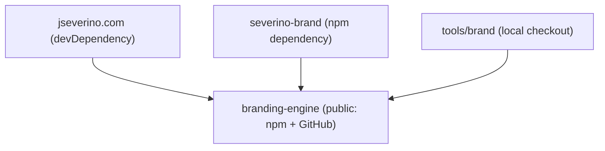

# Brand system

How the brand is defined, how the site renders it, and how to embed its
styles elsewhere.

## The identity

The accent is navy (`#1E3A8A`), which reads as a white glyph on a solid tile at
favicon sizes. It is the favicon and mark tile and the site's theme color
(`--color-primary`, `<meta name="theme-color">`), so logo and interface share
one value.

## Generated assets

The `JS` monogram is built from Inter (weight 800) glyph outlines and laid out
into an SVG. The identity (the navy, the glyph) is synced into
[`src/lib/brand.ts`](../src/lib/brand.ts), and three consumers read it: the
favicon generator, the social-card renderer, and the CSS that sets the theme
color. A change to the color reaches the favicon, the Open Graph card, and the
interface together.

The wordmark lockup (the tile plus the name) is composed from the same Inter
outlines into `wordmark.svg`, and the light and dark PNGs are rasterized from
that SVG. An all-caps lockup matches how the header sets the name. Geometry is
vector; only assets that must be raster (social cards, platform icons) are
raster.

## One engine, many surfaces

The generators know only a color, initials and a name; the brand data lives in
`severino-brand`, the rendering in `branding-engine`.



- The site depends on the engine to regenerate its favicons, social cards, and
  header wordmark, and commits the output. Its production build never runs the
  engine; the header inlines the committed `wordmark-caps.svg` so its glyphs pick
  up the link's hover color through `currentColor`.
- The brand kit, `severino-brand`, is data plus a dependency on the engine;
  building it renders each kit it declares.
- The `brand` tool wraps the engine for use from the terminal.

The engine is the public, reusable piece:
[`branding-engine`](https://github.com/joeseverino/branding-engine). It renders
a kit from one accent color and a set of initials.
[Deployment preview review](./Deployment-Preview-Review.md#what-the-preview-shows)
shows a brand change on a preview beside production.

## How the site consumes it

The site keeps self-contained generated inputs while consuming one versioned
upstream contract:

- `severino-brand/brand/tokens.json` is the one editable source: the brand
  identity (`brand`: navy, glyph), the design system (`designSystem`: the `:root`
  custom properties), and the dark values for the themeable subset of those
  properties (`designSystemDark`). The package's `brand/contract.ts` validates
  that data and derives the semantic web contract (surface, card, theme, and CSS
  roles) once.
- The signed `severino-brand` release is pinned by tag and resolved commit in
  `package-lock.json`; no neighboring checkout or mutable filesystem convention
  participates in synchronization or CI.
- `mise run sync:tokens` ([`bin/sync-tokens.ts`](../bin/sync-tokens.ts)) only
  serializes that normalized contract into `src/lib/brand.ts` and
  `src/styles/tokens.css`. `mise run sync:tokens --check` performs the same
  projection without writing and fails on drift. Each projection embeds the upstream token
  SHA-256 digest for provenance.
- `bin/make-icons.ts`, `bin/make-og-image.ts`, and `bin/make-github-social.ts`
  import `markSvg` / `renderCard` from `branding-engine` and pass it the
  synced `BRAND`. The engine is generic; the tokens supply the color.
- The generated assets in `public/assets/` are committed. `mise run checks:contracts`
  runs `make:icons --check`, which fails when the vector marks (`favicon.svg`,
  `mark.svg`, `wordmark-caps.svg`) differ from what the engine renders. To restyle the brand,
  edit `tokens.json` upstream, run `mise run sync:tokens`, re-run the generators,
  and commit the new tokens and assets together.

### Light and dark from one token block

`designSystemDark` lists only the tokens whose value changes in dark. The renderer
folds the two maps together into a single `:root` block where each themeable token
holds both values at once:

```css
:root {
  color-scheme: light dark;
  --color-bg: light-dark(#ffffff, #131826);
  --color-text: light-dark(#0b0620, #e8eaf2);
  --color-border: color-mix(in oklch, var(--color-text) 8%, transparent);
}
```

There is no dark stylesheet, no `[data-theme]` selector, and no per-component
dark override. Consequences:

- A derived token adapts on its own. `--color-border` is a `color-mix()` over
  `--color-text`, so it has no dark entry and follows the text color. Anything
  expressible as a mix of an already-themeable token stays derived.
- `light-dark()` accepts only colors. `--shadow-md` is geometry plus a color, so
  it composes `--shadow-color-md`, which holds the color. A token that is not a
  bare color splits the same way.
- A dark key with no light counterpart throws. `mergeThemes` in the versioned
  `severino-brand` contract refuses to emit a token that exists only in the dark
  map, so a typo there fails instead of dropping out of the output.

The terminal group (`--code-*`, `--term-*`) has no dark entries on purpose: it
represents a real terminal and stays dark in both themes. `--color-primary` is
dual-valued too, but from `brand.onDark` in `brandVarsCss()` rather than the
design-system block, since it is brand identity and lives in `src/styles/brand.css`. Navy is
unreadable on a dark page; `onDark.primary` is the readable counterpart, and
`onDark.primaryDeep` is *lighter* than it, because "deep" means more emphasis and
emphasis moves toward the far end of the page's contrast range in either theme.

The engine is a devDependency from npm. `mise run checks:contracts` runs
`make:icons --check`, which renders the vector marks with it, so every install
needs it. The production build never runs it: the rendered assets are committed.

## Embedding the styles elsewhere

The site's writeup styling is two concerns in one stylesheet, and anything that
renders writeup HTML outside the site must carry both.

- **`src/styles/base.css`** is the ordered design-system entrypoint. It imports
  concern-based modules for tokens, brand, foundation, layout, content, footer,
  overlays, and accessibility. Astro inlines it, plus the sheet a page imports
  for itself (the contact form, the software list, the resume and education
  documents), into each page as one `<style>` block, pinned by hash in the CSP.
- **`src/styles/brand.css`** is the brand identity: `--color-primary` and
  `--color-primary-deep`, generated by `mise run sync:tokens`.

The two stay in separate files because brand identity (`brand` in `tokens.json`)
is swappable and the design system (`designSystem`) is stable. The design
system's tinted tables, links, and buttons all read `--color-primary`, so
`base.css` pasted raw, without its imports expanded, renders without color.

The assembly is owned once so an embedder does not re-derive it:

- [`src/lib/brand.ts`](../src/lib/brand.ts) exports **`brandVarsCss()`**, the
  `:root` brand-vars string. `sync:tokens` writes exactly this into
  `src/styles/brand.css`, so the site and any embedder share one definition.
- [`src/lib/web-styles.ts`](../src/lib/web-styles.ts) exports
  **`interFontFace(fontUrl)`**, the Inter `@font-face` that `base.css` expects,
  which the document renderer
  ([`bin/lib/render-document.ts`](../bin/lib/render-document.ts)) adds with the
  font as a data URL when it styles a rendered writeup with `base.css`.
  [`bin/make-embed-bundle.ts`](../bin/make-embed-bundle.ts) builds
  `public/embed/bundle.css` with esbuild, which inlines the font `tokens.css`
  declares as a data URL.

## Related docs

- [`docs/Architecture.md`](./Architecture.md)
- [`docs/WordPress-To-Astro-Migration.md`](./WordPress-To-Astro-Migration.md)
- [`branding-engine`](https://github.com/joeseverino/branding-engine) (the engine repo)
