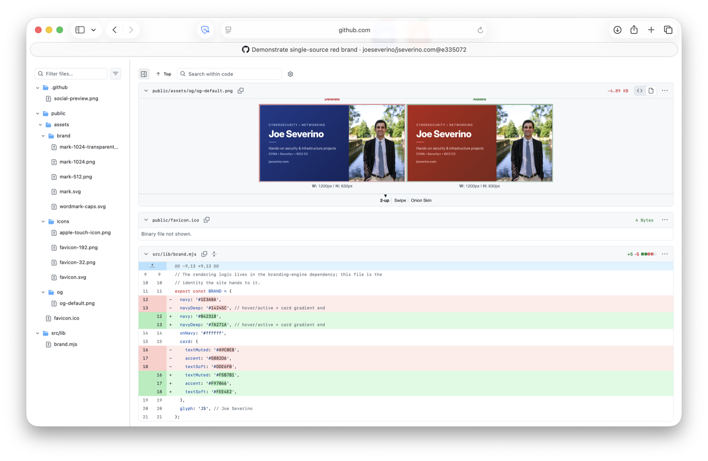
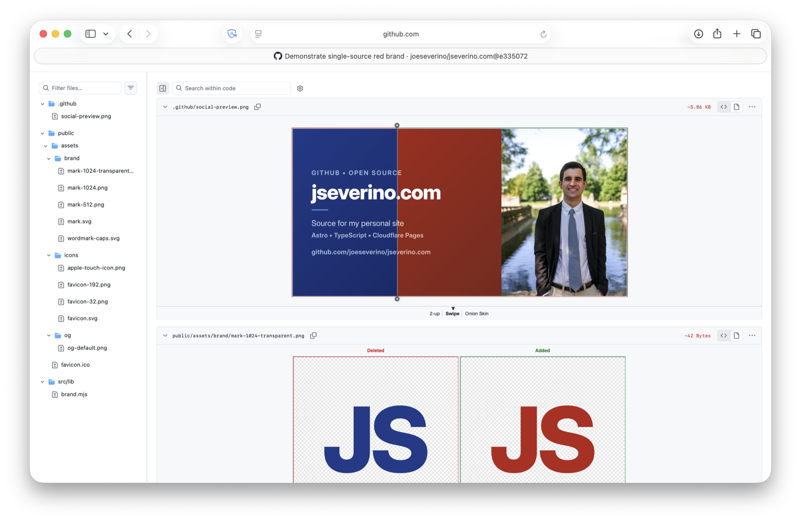
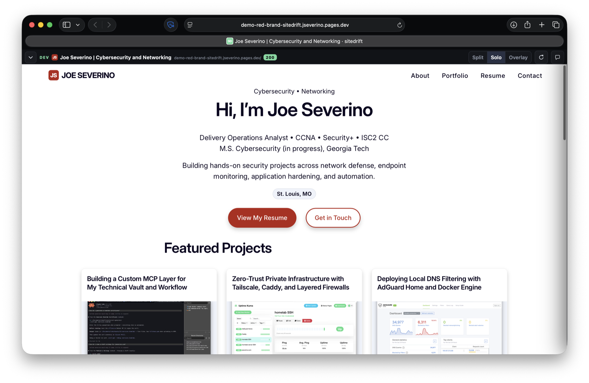
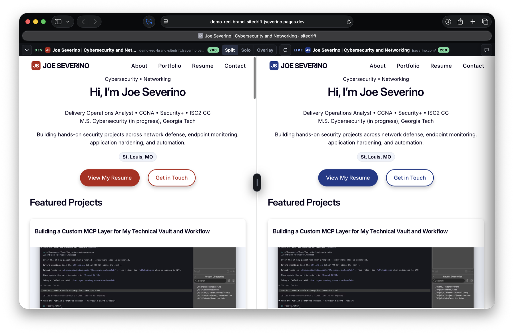
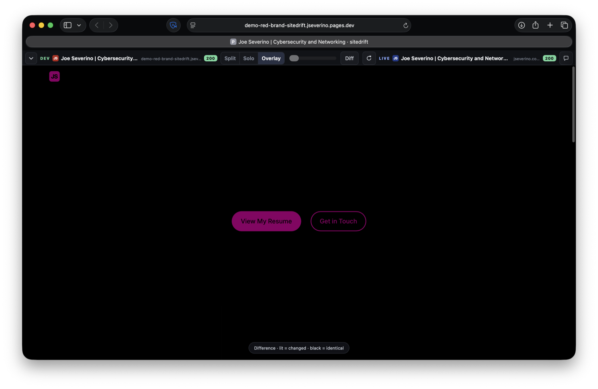
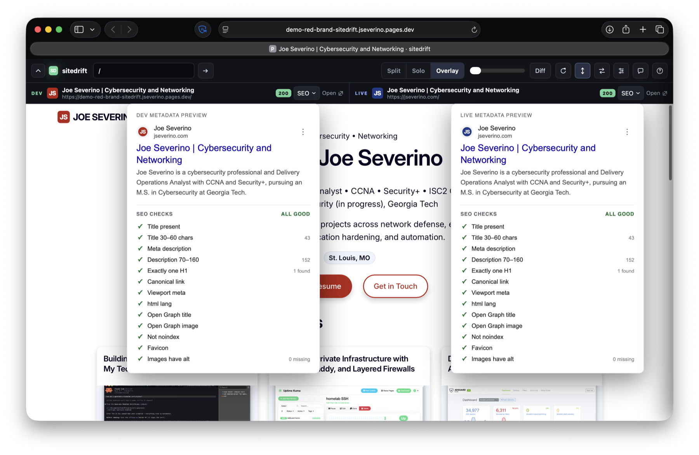
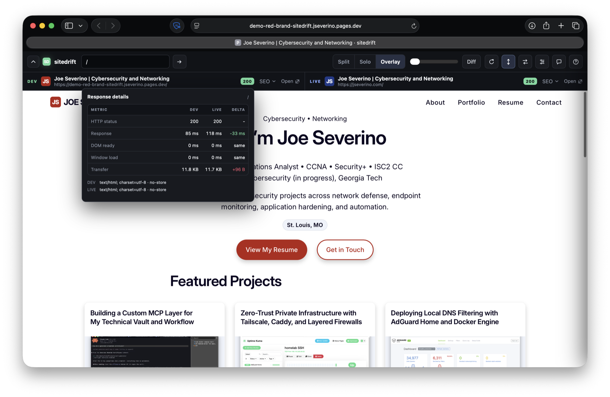
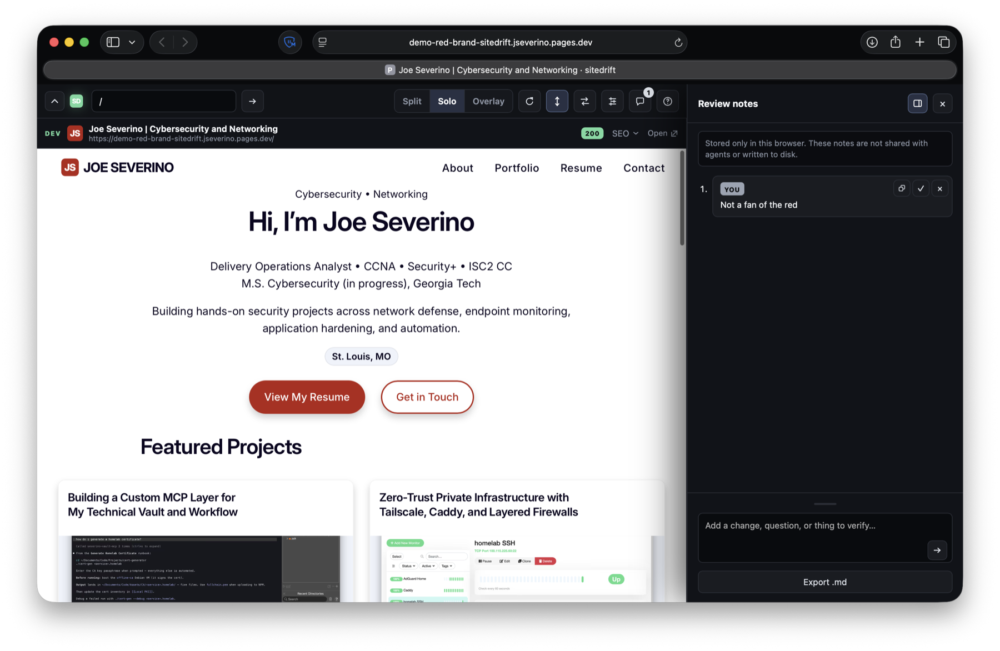
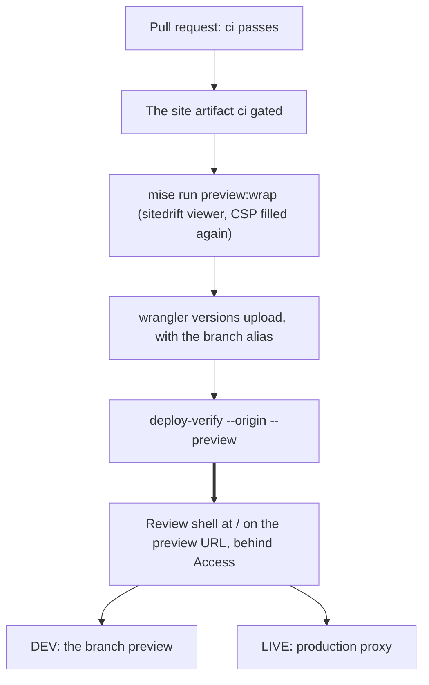

# Deployment preview review

Every pull request's preview of `jseverino.com` carries a compact
[sitedrift](https://github.com/joeseverino/sitedrift) review layer. The preview
is a version of the `jseverino` Worker on its workers.dev preview URL
([Preview access](./Cloudflare.md#preview-access)); it is DEV, and the current
`https://jseverino.com` release is LIVE. Sitedrift's README lists every mode
and check the layer offers.

## What the preview shows

The captures below are of a preview whose one change is the primary brand
token, red in place of navy.
[`branding-engine`](https://github.com/joeseverino/branding-engine) regenerates
the favicon, marks, header wordmark, interface color, Open Graph card, and
GitHub social preview from that token, and the preview shows how far the
change reaches.

Solo mode presents DEV as the interactive site with a compact review bar; the
layer leaves navigation, menus, scrolling, and responsive layout working.

Split mode places DEV and LIVE on the same route and scroll position. Structure
and content stay aligned, and the change appears in the mark, buttons, and the
other generated surfaces.

Overlay Diff mode turns identical pixels black and leaves changed pixels lit,
so a brand-only change shows only the brand surfaces.

Both deployments get the same metadata preview and SEO checklist: title,
description, canonical URL, headings, Open Graph fields, favicon, and image-alt
coverage.

The response popover shows HTTP status, response time, transfer size, and
deltas: same-session diagnostics that expose a branch that fails, redirects,
or gets heavier.

Review notes live only in that browser's `localStorage`, and the interface says
so. They need no account system, write API, or database.

## Repository integration

No separate review server exists. Once `ci` passes, the `preview` workflow
wraps the build `ci` gated in the sitedrift viewer and uploads it as a Worker
version tagged with the commit. Its `deploy` check on the commit names the
version's own URL, which never moves, and the branch alias, which follows the
next push.

The build is the same for production and a preview. The `preview` workflow's
`preview` job wraps it afterwards with `mise run preview:wrap`
([`bin/wrap-preview.ts`](../bin/wrap-preview.ts)), which:

1. refuses `dist/server/wrangler.json` unless every key is one the Cloudflare
   adapter writes, it names the `jseverino` Worker, and its script and assets
   sit inside the build, since wrangler reads that file beside the Cloudflare
   token;
2. calls sitedrift's `installCloudflarePreview` on `dist/client/`, with the
   origin and owner from [`src/lib/site-config.ts`](../src/lib/site-config.ts),
   to install the DEV-versus-LIVE review shell and keep the original pages
   under `__sitedrift_source/`;
3. runs [`bin/build-csp.ts`](../bin/build-csp.ts) again from
   `dist/_headers.template`, so the policy hashes the viewer's inline tags,
   which carry the same `__CSP_INLINE__` marker as the site's.

The job then uploads and verifies the version
([Architecture](./Architecture.md#14-release-gate) has the job sequence).

The scoped on-demand route,
[`src/integrations/sitedrift-route.ts`](../src/integrations/sitedrift-route.ts),
runs sitedrift's own preview handler in the site's Worker. Its defaults are
this route's guards:

- `404` on the production host (and its `www.`) and on any build without
  sitedrift's generated config;
- only content-negotiation headers (`accept`, `accept-language`, conditional and
  range headers, `user-agent`) reach production; cookies, `authorization`, and
  Access headers never do, and production's `set-cookie` is dropped;
- responses get the security headers back, and LIVE pages are served under a
  request-time CSP: a nonce for the bridge script sitedrift injects, plus a hash
  for each inline script and style of the fetched page.

`tests/unit/csp.test.ts` covers that request-time policy.

`sitedrift` is pinned in `devDependencies` and locked in `package-lock.json`.

## Preview build flow

The branch alias and the version URL expose the same interface. Verify against
the version URL, which cannot move to a newer build mid-test.

## Production invariant

Production is never wrapped. The `production` job ships the build as `ci`
left it and never runs the wrap, and `installCloudflarePreview` itself leaves
the output unchanged unless `WORKERS_CI=1` names a branch other than `main`.

The route is part of the Worker, so it still exists in production. It answers
`404` there on the production host check and on the
missing generated config. The `sitedrift-production` WAF rule also blocks
`/__sitedrift*` on the production hosts at the edge. The site, contact form, CSP
report receiver, headers, and static assets are unchanged.

`mise run checks:unit` runs the deploy's own wrap on simulated outputs
([`tests/unit/wrap-preview.test.ts`](../tests/unit/wrap-preview.test.ts)) and
asserts that a feature branch receives the wrapper, with the CSP filled again,
while `main` stays the original Astro document.

## Security boundary

- The route owns only `/__sitedrift/*`.
- It allows only `GET` and `HEAD`.
- The LIVE destination is fixed at build time to `https://jseverino.com`.
- It does not forward contact-form writes, arbitrary origins, cookies, or
  credentials.
- Hosted frames execute trusted first-party preview code.
- Notes never leave the browser and are not available through the sitedrift MCP.
- The API routes keep their paths; static pages never start the Worker.
- Preview hostnames carry `X-Robots-Tag: noindex` and admit only service
  tokens ([Preview access](./Cloudflare.md#preview-access)).

The surface is read-only: no account system, production content API, database
binding, secret, upload endpoint, or public write path.

## Review procedure

1. Open the version URL the commit's `deploy` check names.
2. Confirm DEV Solo mode renders the intended branch.
3. Switch DEV/LIVE and inspect the same route.
4. Use Split with linked scrolling for layout and content review.
5. Use Overlay/Diff for pixel-level changes.
6. Open each status badge and review response/load deltas.
7. Open SEO and compare title, description, canonical, snippet, and checks.
8. Check navigation, menus, scrolling, desktop Chromium, and mobile WebKit.
9. Keep browser-local notes free of sensitive information.
10. Confirm the production guard before merging to `main`.

## Dependency updates

Renovate opens each sitedrift update in a pull request of its own
([Dependencies](./Dependencies.md#updates)). Review the upstream release notes
and the pull request's preview before merging. A sitedrift update changes both build tooling (HTML transform) and the
preview runtime (edge proxy).

## Related docs

- [Architecture](./Architecture.md)
- [SEO](./SEO.md)
- [Release Checklist](./Release-Checklist.md)
- [Security](../.github/SECURITY.md)
