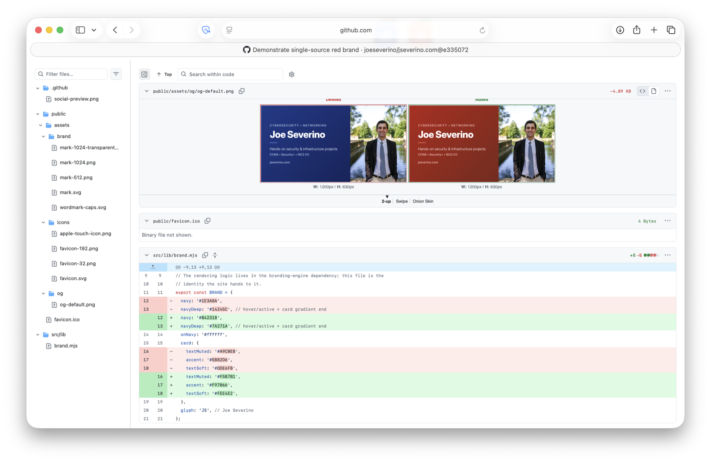
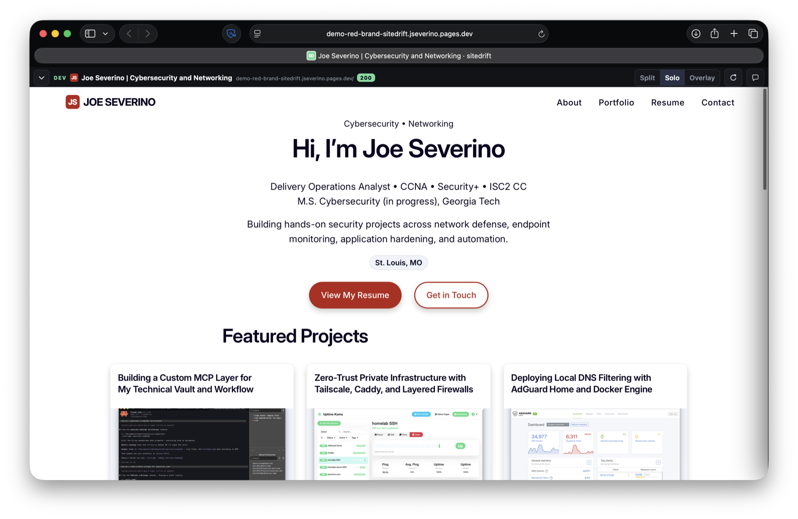
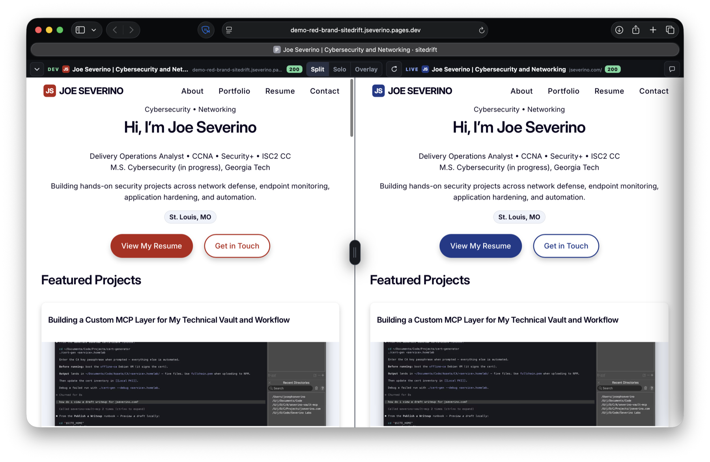
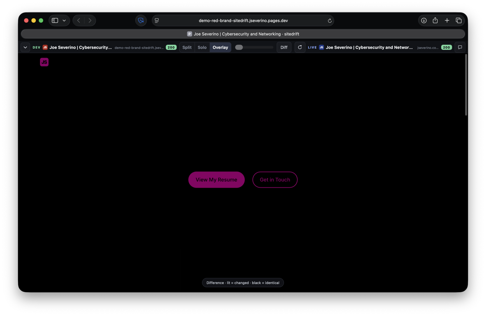
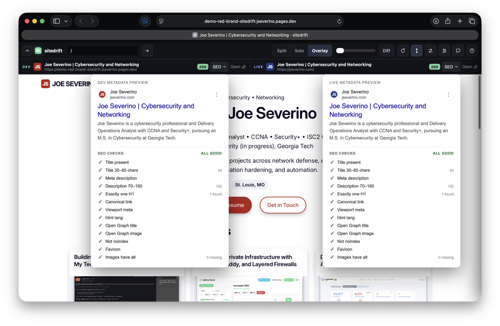
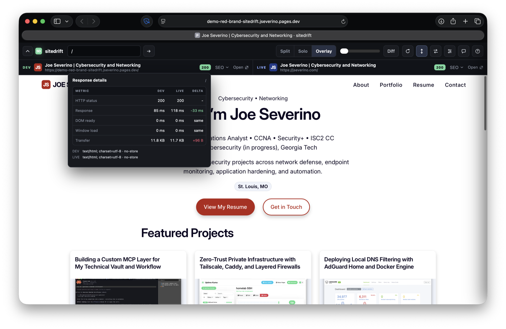
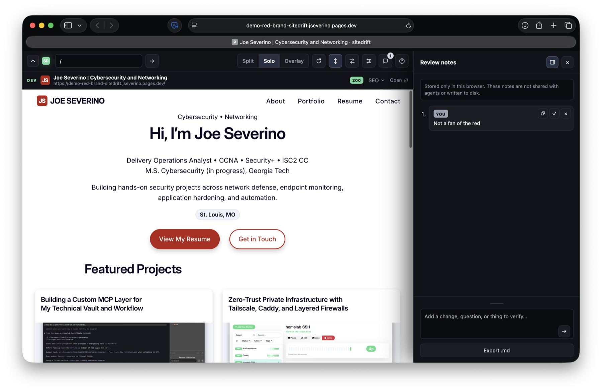
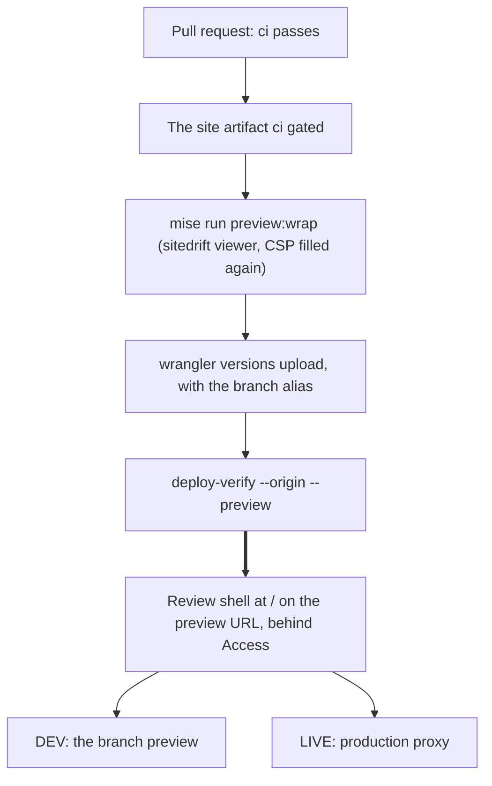

# Deployment Preview Review

Every pull request's preview of `jseverino.com` carries a compact
[sitedrift](https://github.com/joeseverino/sitedrift) review layer. The preview
is a version of the `jseverino` Worker on its workers.dev preview URL
([Preview access](./Cloudflare.md#preview-access)); it is DEV, and the current
`https://jseverino.com` release is LIVE.

## Case Study: One Brand Change, Fully Reviewed

Two public tools: [`branding-engine`](https://github.com/joeseverino/branding-engine)
generates a brand system from structured inputs, and
[`sitedrift`](https://github.com/joeseverino/sitedrift) compares a development
deployment with the live site.

The demonstration changed the primary brand token in `src/lib/brand.ts` from
navy to red. `branding-engine` propagated that one decision through the favicon,
marks, header wordmark, interface color, Open Graph card, and GitHub social
preview. Only the branch's preview received the change; production stayed navy.

### 1. Turn A Commit Into A Reviewable Version

No separate review server exists. Once `ci` passes, the `deploy` workflow wraps
the build `ci` gated in the sitedrift viewer and uploads it as a Worker version
tagged with the commit. Its `deploy` check on the commit names the version's own
URL, which never moves, and the branch alias, which follows the next push.

### 2. Confirm The Branch Works By Itself

Solo mode presents DEV as a normal, interactive website with a compact review
bar. The layer must not break navigation, menus, scrolling, or responsive layout.

### 3. Compare The Complete Result With Production

Split mode places the red branch and navy production site on the same route and
scroll position. Structure and content stay aligned; the brand change appears in
the mark, buttons, and other generated surfaces. `branding-engine` made the
change; `sitedrift` shows how far it reached.

### 4. Isolate Changed Pixels

Overlay Diff mode turns identical pixels black and leaves changed pixels lit.
The sparse result shows the branch changed branding, not layout or content.

### 5. Check More Than Appearance

Both deployments receive the same metadata preview and SEO checklist. Here the
title, description, canonical URL, headings, Open Graph fields, favicon, and
image-alt coverage all pass, so the redesign carries no SEO regression.

The response popover shows HTTP status, response time, transfer size, and
deltas. These are same-session diagnostics, not benchmarks, and expose a branch
that fails, redirects, or gets heavier.

### 6. Leave Review Context Without Adding A Service

Review notes live only in that browser's `localStorage`, and the interface says
so. They need no account system, write API, or database.

## What Reviewers Get

- **Solo** view by default, with one-click switching between DEV and LIVE.
- **Split** view with synchronized routes, links, and scrolling.
- **Overlay** and pixel-difference modes for visual drift.
- Per-side HTTP status plus response, DOM-ready, load, transfer, header, and
  delta details.
- A Google-style SEO preview for both sides.
- Metadata comparison for title, description, and canonical URL.
- SEO checks for title and description quality, H1 count, canonical, viewport,
  language, Open Graph metadata, indexing directives, favicon, and image alt
  coverage.
- Review notes stored only in that browser's `localStorage`.

## Repository Integration

The build is the same for production and a preview. The `deploy` workflow's
`preview` job wraps it afterwards with `mise run preview:wrap`
([`bin/wrap-preview.ts`](../bin/wrap-preview.ts)), which:

1. refuses `dist/server/wrangler.json` unless every key is one the Cloudflare
   adapter writes, it names the `jseverino` Worker, and its script and assets
   sit inside the build, since wrangler reads that file beside the Cloudflare
   token;
2. calls sitedrift's `installCloudflarePreview` on `dist/client/`, with the
   origin and owner from [`src/lib/site-config.ts`](../src/lib/site-config.ts),
   to install the DEV-versus-LIVE review shell and keep the original pages
   under `__sitedrift_source/`;
3. runs [`bin/build-csp.ts`](../bin/build-csp.ts) again from
   `dist/_headers.template`, so the policy hashes the viewer's inline tags,
   which carry the same `__CSP_INLINE__` marker as the site's.

The job then uploads and verifies the version
([Architecture](./Architecture.md#14-release-gate) has the job sequence).

The scoped on-demand route,
[`src/integrations/sitedrift-route.ts`](../src/integrations/sitedrift-route.ts),
runs sitedrift's own preview handler in the site's Worker. Its defaults are
this route's guards:

- `404` on the production host (and its `www.`) and on any build without
  sitedrift's generated config;
- only content-negotiation headers (`accept`, `accept-language`, conditional and
  range headers, `user-agent`) reach production; cookies, `authorization`, and
  Access headers never do, and production's `set-cookie` is dropped;
- responses get the security headers back, and LIVE pages are served under a
  request-time CSP: a nonce for the bridge script sitedrift injects, plus a hash
  for each inline script and style of the fetched page.

`tests/unit/csp.test.ts` covers that request-time policy.

`sitedrift` is pinned in `devDependencies` and locked in `package-lock.json`.

## Preview Build Flow

The branch alias and the version URL expose the same interface. Verify against
the version URL, which cannot move to a newer build mid-test.

## Production Invariant

Production is never wrapped. The `production` job ships the build as `ci`
left it and never runs the wrap, and `installCloudflarePreview` itself leaves
the output unchanged unless `WORKERS_CI=1` names a branch other than `main`.

The route is part of the Worker, so it still exists in production. It answers
`404` there on the production host check and on the
missing generated config. The `sitedrift-production` WAF rule also blocks
`/__sitedrift*` on the production hosts at the edge. The site, contact form, CSP
report receiver, headers, and static assets are unchanged.

`mise run checks:unit` runs the deploy's own wrap on simulated outputs
([`tests/unit/wrap-preview.test.ts`](../tests/unit/wrap-preview.test.ts)) and
asserts that a feature branch receives the wrapper, with the CSP filled again,
while `main` stays the original Astro document.

## Security Boundary

- The route owns only `/__sitedrift/*`.
- It allows only `GET` and `HEAD`.
- The LIVE destination is fixed at build time to `https://jseverino.com`.
- It does not forward contact-form writes, arbitrary origins, cookies, or
  credentials.
- Hosted frames execute trusted first-party preview code.
- Notes never leave the browser and are not available through the sitedrift MCP.
- The API routes keep their paths; static pages never start the Worker.
- Preview hostnames carry `X-Robots-Tag: noindex` and admit only service
  tokens ([Preview access](./Cloudflare.md#preview-access)).

The surface is read-only: no account system, production content API, database
binding, secret, upload endpoint, or public write path.

## Review Procedure

1. Open the version URL the commit's `deploy` check names.
2. Confirm DEV Solo mode renders the intended branch.
3. Switch DEV/LIVE and inspect the same route.
4. Use Split with linked scrolling for layout and content review.
5. Use Overlay/Diff for pixel-level changes.
6. Open each status badge and review response/load deltas.
7. Open SEO and compare title, description, canonical, snippet, and checks.
8. Check navigation, menus, scrolling, desktop Chromium, and mobile WebKit.
9. Keep browser-local notes free of sensitive information.
10. Confirm the production guard before merging to `main`.

## Dependency Updates

Renovate opens each sitedrift update in a pull request of its own
([Dependencies](./Dependencies.md#updates)). Review the upstream release notes
and the pull request's preview before merging. A sitedrift update changes both build tooling (HTML transform) and the
preview runtime (edge proxy).

## Related Docs

- [Architecture](./Architecture.md)
- [SEO And Metadata](./SEO.md)
- [Release Checklist](./Release-Checklist.md)
- [Security](../SECURITY.md)
