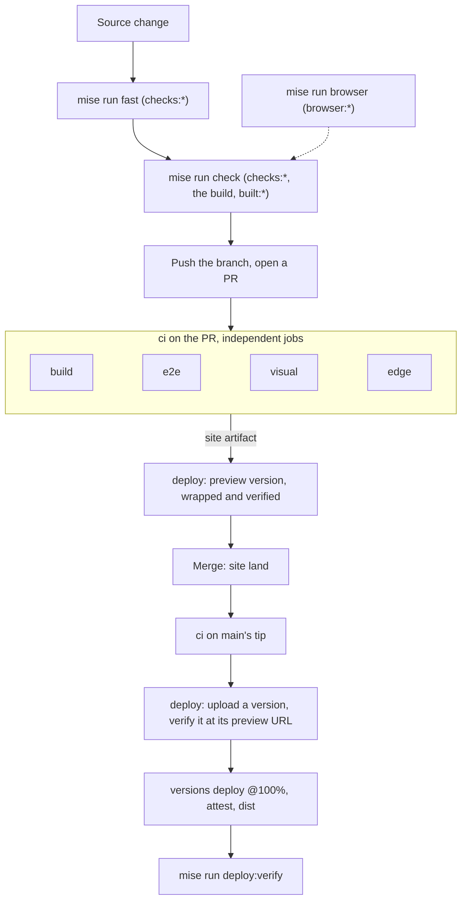

# Development

How the repository is built, checked, and shipped. Every script is in
[Commands](./Commands.md); the test suites are toured in
[`tests/README.md`](../tests/README.md).

## Setup

[mise](https://mise.jdx.dev) installs the toolchain: Node, pinned in
[`mise.toml`](../mise.toml) with its checksums in [`mise.lock`](../mise.lock).
npm comes from `package.json`'s `packageManager`. `mise install` installs the
tools. The npm packages come from mise's `[deps.npm]` provider: before any
`mise run` or `mise exec`, it runs `npm ci` from the lockfile whenever
`package.json` or `package-lock.json` changed since the last install or
`node_modules` is missing, so a fresh checkout or a pull that moves the
lockfile is installed by the first task it runs (`mise deps install npm` runs
it on its own). CI installs packages per job in its setup action instead.
Machine paths for the content sync go in a gitignored
`mise.local.toml` ([Vault Workflow](./Vault-Workflow.md#local-workflow)).

The contact form needs Cloudflare Turnstile keys. For local work, put
Turnstile's always-passing test keys in a gitignored `.env`:

```sh
PUBLIC_TURNSTILE_SITE_KEY=1x00000000000000000000AA
TURNSTILE_SECRET_KEY=1x0000000000000000000000000000000AA
```

Astro reads the site key at build time, and the local Worker runtime
(`mise run dev`, `mise run preview`) reads the secret. With a test secret,
[`turnstile.ts`](../src/lib/api/turnstile.ts) also accepts siteverify's test
hostname (`localhost`) and action (`test`); any other secret requires
`jseverino.com` and the contact action. Production keeps the site key as a
repository variable and the secret as a Worker secret
([Cloudflare](./Cloudflare.md#worker-configuration)). Then:

```sh
mise install
mise doctor project                     # is this checkout ready to work in
mise run dev                            # Astro dev server
mise run build && mise run preview      # the build on the Workers runtime
```

`mise doctor project` runs the readiness checks `mise.toml` declares under
`[doctor.checks]`: the npm packages match the lockfile, `gh` is signed in,
the cache root exists, and Playwright's browsers are installed. Each failure
prints its fix. It never runs on
its own and is no gate: CI has no `gh` login, and the checks describe this
machine, not the change.

Every checkout and worktree shares one cache root, `SITE_CACHE_DIR` in
`mise.toml`'s `[env]` (under the platform cache directory): the content
sync's image masters, and Astro's encoded images in `astro/`.

## Code

Everything is TypeScript, run directly by Node 24, which strips the types: no
build step and no loader. Syntax Node cannot strip (enums, namespaces, parameter
properties) is out, so `erasableSyntaxOnly` is on and every relative import
names its `.ts` file. `mise run checks:types` is the one strict
check over the repo; `astro check` covers the `.astro` files. Shared logic lives
once, in `bin/lib/`, `src/lib/`, or a test helper, and the
gate fails on duplicated code.

## Gates

```sh
mise run fast             # the static gates: types, policy, docs, lint, duplication, unit tests, astro check
mise run check            # + the production build, then every gate on it (CI's build job)
mise run browser          # the browser suites, one at a time: e2e, visual, edge
mise run ci               # check, then browser: every gate the pipeline runs
mise run diff:build       # build HEAD and the working tree, report any change to shipped output
mise run deploy:verify    # after a merge: required checks, then the live deployment
```

Every gate is a mise task named `<job>:<gate>` (`mise tasks` lists them; the
[task list](./Commands.md#every-task) says what each asserts), and CI runs the same
tasks. The gates validate the current checkout without vault access; run
`mise run sync:content` explicitly before checking new editorial content. A
failing gate prints its own fix. Signature verification uses an isolated
keyring containing only the committed WKD public keys. Unit-test Git
repositories disable signing locally; production commit signing remains
configured by the author.



## Test policy

New functionality ships with automated coverage in the same change, and a fix
for a reproducible defect ships with a regression test, at the layer that
matches what changed:

| Change | Layer |
| :--- | :--- |
| Pure library logic | [`tests/unit/`](../tests/unit/) |
| An invariant about the source tree | [`tests/audits/`](../tests/audits/) |
| Rendered or interactive behavior | [`tests/playwright/`](../tests/playwright/) |
| Headers, CSP, or the API routes as the Workers runtime serves them | [`tests/edge/`](../tests/edge/) |

A new audit is a task in `mise.toml`;
[`tests/ARCHITECTURE.md`](../tests/ARCHITECTURE.md#adding-a-new-audit) has the
steps.

## Continuous integration

| Workflow | Trigger | Does | Verified result |
| --- | --- | --- | --- |
| [`ci`](../.github/workflows/ci.yml) | push and pull request to `main` | `build` runs `mise run check` and uploads the build as the `site` artifact; the `playwright` matrix runs `e2e`, `visual`, and `edge`, one `browser:*` task per leg. No job waits on another. [Architecture](./Architecture.md#14-release-gate) has each job. | Green checks on the committed tree and a summary on every browser leg. |
| [`deploy`](../.github/workflows/deploy.yml) | `ci` completed successfully | Ships `ci`'s `site` artifact: a pull request's build as an Access-protected preview version, `main`'s tip as a version verified at its preview URL before it takes all traffic, then attested and committed to the [`dist` branch](./Dist-Branch.md). [Architecture](./Architecture.md#14-release-gate) has each job. | A `deploy` check on every shipped commit; the `release-<sha>` artifact for each production deploy. |
| [`dependency review`](../.github/workflows/dependency-review.yml) | pull request | Audits manifest package updates for high-severity advisories, passing at once when no manifest changed; comments only when it blocks. | Pull request status validation. |
| [`release`](../.github/workflows/release.yml) | `v*` tag | Publishes the tagged commit's production deploy: the `release-<sha>` artifact the `deploy` workflow attested (the archive production served, its CycloneDX SBOM, and both Sigstore bundles). Nothing is rebuilt, so a tag on a commit `main` never deployed fails. The tag is signed by convention; the trigger does not verify it. | A GitHub release whose files verify with `gh attestation verify`. |
| [`scorecard`](../.github/workflows/scorecard.yml) | weekly, branch-protection change | OpenSSF Scorecard supply-chain posture, uploaded as SARIF to code scanning. | A code scanning alert per check with findings. |
| [`link check`](../.github/workflows/link-check.yml) | docs changes, weekly | Lychee audits repository documentation links and public content links separately (self-domain links excluded; 403/429/999 accepted as answered), writes both reports into the job summary, and uploads them. | Connectivity report artifacts. |
| [`lighthouse`](../.github/workflows/lighthouse.yml) | weekly | `mise run lighthouse` runs the lockfile's Lighthouse (the same generation PageSpeed Insights scores with) against the live URLs in `tests/lighthouse.json`. | Fails below accessibility 95 or SEO 90; warns below performance 85 or best practices 70. Scores in the job summary, reports as artifacts. |
| [`security.txt expires`](../.github/workflows/security-txt-expires.yml) | monthly | Runs `mise run checks:security-txt`, which fails from 60 days before `security.txt` expires. | A failed scheduled run, which GitHub emails. |

CodeQL runs as GitHub's default setup on pushes, pull requests and a weekly
schedule, declared in [`.github/repo.json`](../.github/repo.json) with the
`main` ruleset's code scanning rule, which holds a merge on a high-severity
alert ([GitHub Settings](./GitHub-Settings.md)).

Workflow hardening (pinned actions, job-scoped permissions, credential-free
checkouts) is in [Security](./Security.md#supply-chain-and-ci).

## Documentation

Docs change in the same commit as the code they describe. `mise run checks:doc-links`
(lychee, offline) fails when a relative link, anchor, or image points at
nothing, and `mise run checks:docs` when a `mise run` reference or a
backticked repo path does, or a doc runs an npm script. Both read only tracked files. The task list in
`docs/Commands.md` is generated:
`mise generate task-docs --inject --output docs/Commands.md`.
