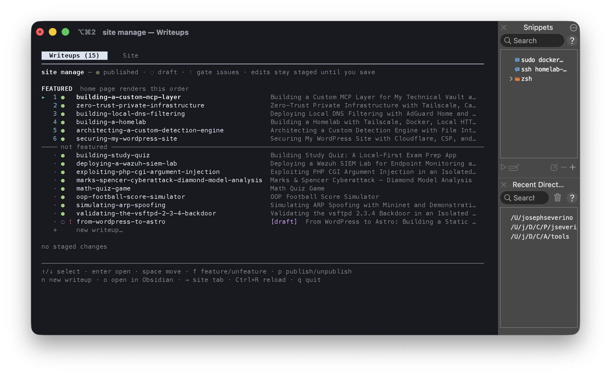
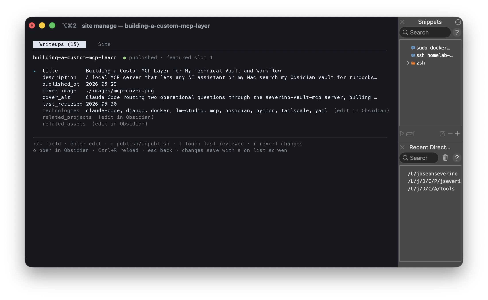
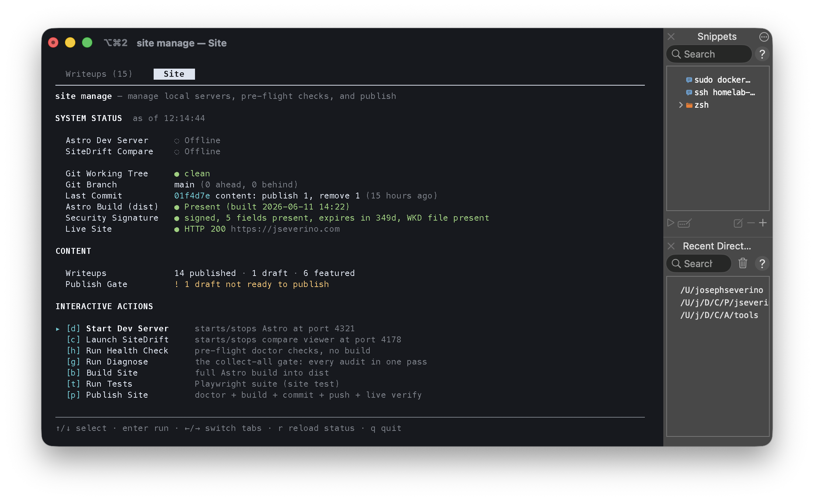
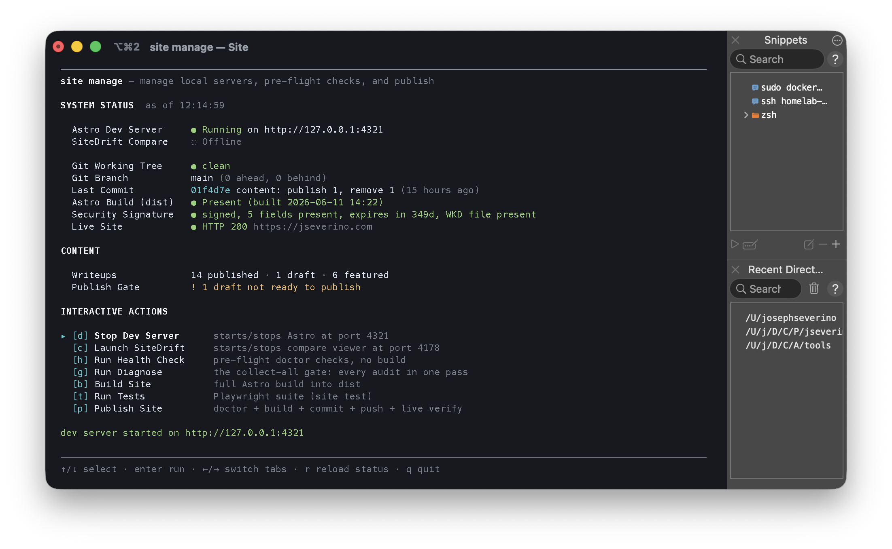

# Site CLI

`site` is this repository's publishing workflow: vault, repo snapshot, pull
request, production. It lives here, in [`bin/site.ts`](../bin/site.ts)
and [`bin/site/`](../bin/site/), on top of the same modules the other mise tasks
use: the content sync ([`bin/content-sync/`](../bin/content-sync/)), the
content diff ([`bin/content-diff.ts`](../bin/content-diff.ts)), the shared
preflight ([`bin/lib/preflight.ts`](../bin/lib/preflight.ts)), and the
mise gates.

```sh
mise run site <command>
```

Arguments after `site` go to the CLI unchanged, `--help` included. The rest
of this page writes a command as `site <command>`.

## Built for an agent caller

Every non-interactive command:

- answers `--help` and rejects unknown flags (exit 2);
- never prompts: a missing confirmation or argument is an error naming the
  flag;
- with `--json`, prints exactly one JSON document on stdout, progress on
  stderr:

  ```json
  { "protocolVersion": 1, "ok": true, "command": "publish", "status": "pr-opened", "pr": "https://…", "next": "…" }
  { "protocolVersion": 1, "ok": false, "command": "publish", "status": "failed",
    "error": { "message": "preflight failed: deps", "code": 3, "fix": "cd … && npm ci" } }
  ```

  The document's type is `SiteResult` in [`bin/site/types.ts`](../bin/site/types.ts),
  a union discriminated by `ok` and `command`, so a caller can import it.
  `apply-plan`, `set`, and `link` add a `receipt` for each completed write:
  audit and cache-invalidation evidence, never a second source of truth.
  `site dev --json` sends Astro's own output to stderr; when Astro detects an
  agent it serves in the background (`astro dev --background`), and the
  result carries `background: true` with the server's `url` and `pid`.
- with `--json`, sets `SITE_JSON=1` for every process the command starts.
  Under it, [`bin/build-static.ts`](../bin/build-static.ts) runs
  `astro build --json` and the astro-check audit runs `astro check --json`,
  so Astro logs one `{message,label,level}` JSON line per event.
  `@astrojs/check` still prints its diagnostics and the `Result (N files)`
  summary as text. Without `--json`, output is unchanged.
- with `--help --json` (or `site help [<command>] --json`), prints the usage
  as one `SiteHelp` document: usage, options, positional bounds, exit codes,
  and for `site help` every command with an `interactive` flag;
- exits `0` ok, `1` failed, `2` usage, `3` preflight (the environment is not
  ready), `4` timed out.

`site manage` is interactive and prints no result, so `site manage --json` is
a usage error (exit 2, with the JSON error document).

### Protocol

Every document carries `protocolVersion`, currently `1`.
[`site-protocol-v1.json`](../public/schemas/site-protocol-v1.json), published at
`https://jseverino.com/schemas/site-protocol-v1.json`, is the JSON Schema (2020-12)
for the envelope and for the `site apply-plan` input. Each command's own fields
are its type in [`bin/site/types.ts`](../bin/site/types.ts). A command may add
fields within a version; removing or retyping one is `protocolVersion` 2. The
unit tests run real commands and validate their output against the schema.

The content model a client edits against is
[`contracts/content.v1.json`](../contracts/content.v1.json), printed by
`site contract`.

## Commands

| Command | Does |
| :--- | :--- |
| `site new <slug>` | Scaffold `05 Writeups/<slug>/` from the vault template (`published: false`) |
| `site validate [<slug>] [--draft]` | Resolve every reference, the frontmatter contract, and the catalog without writing (`sync-content --check`) |
| `site dev [--drafts] [--host <host>] [--port <port>]` | Astro dev server; drafts come from the gitignored `.cache/drafts` overlay, never the committed snapshot |
| `site publish [--dry-run] [--full] [--from <ref>]` | Preflight, a `content/<date>` branch from `origin/main` (or `--from <ref>`) in a temporary worktree, sync, content diff, `mise run fast` (`--full`: `mise run check`), a commit of exactly the declared outputs, push, open the PR. Never merges |
| `site land [<pr>] [--timeout <min>]` | A PR into `main` (the latest open `content/*` PR when none is named): read the required checks from `main`'s ruleset and wait until each has reported and passed on the PR head, squash-merge pinned to that head, wait for the merge commit's Cloudflare Pages deploy, verify each published or edited writeup live (removed ones must 404), then `hq sync` if that CLI exists. `--timeout` bounds the waits for checks and deploy. Merges only when invoked |
| `site verify <slug> [--origin <url>]` | Live checks for one writeup (`bin/deploy-verify.ts --slug`), on production or on the deployment at `--origin` |
| `site status` | Repo, dependency, vault, build, and open content PR state |
| `site featured [<slug> <slot\|up\|down\|top\|bottom\|off>]` | Show or reorder the home-page featured list (renumbers `1..N`) |
| `site tech [<query>]` | Search the technology catalog |
| `site seo <page> [--result]` | Search-snippet preview from the last build |
| `site draft-alt <slug>\|--all [--apply]` | Draft `cover_alt` from the cover image (Claude API); `--all` drafts for every published writeup missing one |
| `site writeups [--filter all\|published\|draft\|featured]` | Every writeup with its publish and featured state |
| `site dashboard` | Every writeup, the featured order, the draft gate, and the `sourceFingerprint` a plan is checked against |
| `site tag <slug>` | Which writeups use a technology slug, and how many are published |
| `site prepare <slug> [--tag-usage]` | Publish readiness for one writeup: the ship gate plus its featured slot |
| `site apply-plan [--file <plan.json>]` | Field updates and the complete featured order in one transaction (plan on stdin or `--file`) |
| `site set <slug> [--<field> <value>...] [--published true\|false] [--touch-last-reviewed]` | Set editable frontmatter fields; the flags come from the content contract |
| `site link <slug> --label <text> --from <url> --to <url>` | Replace one exact Markdown link in a writeup body |
| `site contract` | The writeup field contract and its fingerprint |
| `site render <slug\|-> [--document]` | One writeup body (`html`) rendered exactly as the build ships it, from the vault or stdin (`-`); `--document` adds `document`, a self-contained page in the site's article layout with its styles inlined, for previews |
| `site contact [--limit <n>] [--pii]` | Recent contact submissions from D1, redacted unless `--pii` (audited; no rows are released if the audit line cannot be written) |
| `site csp [--count] [--limit <n>] [--directive <name>] [--pii]` | CSP reports from D1, or counts by directive |
| `site d1-apply --confirm` | Apply `cloudflare/d1.sql` to the remote D1 database |
| `site headers [<path>]` | Live security headers on one path, with named pass/fail checks |
| `site manage` | The interactive manager (below) |

The everyday loop: `site new`, write, `site validate <slug> --draft`, set
`published: true`, `site publish`, review the preview on the PR, `site land`.

## How publish behaves

- **The checkout stays as it is.** The branch is cut from `origin/main` (or
  the ref `--from` names) in a temporary worktree, whatever branch the
  checkout is on.
- **The commit is exactly what the sync owns.** The sync reports every file it
  wrote or removed (`--report`); publish stages that set and stops if anything
  else changed.
- **Fails in seconds.** Stale `node_modules`, an unfetchable remote,
  unauthenticated `gh`, an unreachable vault, or uncommitted tracked changes
  stop it before any work, with the fix.
- **Any `git`/`gh` failure is fatal**, with its stderr. Every `gh pr` call names
  the repository (`-R`), so a fork or second remote is never the target.
- **The PR body speaks in slugs**: published, edited, and removed writeups with
  their URLs; generated files as a count.

## How the layers relate

| Layer | Owns | Examples |
| :--- | :--- | :--- |
| mise tasks | gates, the build, and tools | `mise run check`, `mise run sync:content` |
| `site` | the workflow across vault, repo, PR, and live site | `site publish`, `site land` |
| [`bin/lib/writeups/`](../bin/lib/writeups/) | the writeup store: reads and transactional writes to `05 Writeups/` | `listWriteups`, `applyPlan` |
| [`bin/lib/site-ops.ts`](../bin/lib/site-ops.ts) | fixed live-site operations: D1 reads, the schema apply, header checks | `contactSubmissions`, `checkSecurityHeaders` |

Every write to writeup frontmatter (featured order, publish flags, field edits
in `site manage`, `site set`, `site featured`) goes through the writeup store:
format-preserving line edits, a sequential `1..N` featured order, and an
all-or-nothing transaction with rollback. The store and the site operations are
typed functions with no console output and injected paths, so other callers
(HQ) can import them or drive the same commands with `--json`. The repo writes
the vault only through the store and `site new`, which copies the template.

## `site manage`: the TUI

Keyboard transitions live in `bin/site/manage-input.ts`: each mode updates staged
state and returns a typed effect when an operation needs I/O. The controller in
`bin/site/manage.ts` executes those effects. Frames in `bin/site/manage-render.ts`
render loaded state without probing the filesystem or starting commands. The
transition tests cover edits, confirmations, navigation, and text input; terminal
replay tests exercise the controller against a temporary vault.


The one interactive command; it refuses to start without a terminal. A full-screen terminal app over the whole publishing surface: a
**Writeups** tab for content state and a **Site** tab for operations. `←`/`→`
(or Tab) switch between them. Nothing on the Writeups tab is written until
`s` is pressed: changes are staged locally and then applied through the vault
MCP, so the TUI cannot produce a frontmatter state the publish gate would
not. The terminal window title tracks where you are and restores the shell's
title on exit.

### Writeups tab



The featured list renders in the exact order the home page does, with
everything else below the divider. Per row: `●` published, `◌` draft, `▲`/`▼`
staged publish flips, red `!` where the publish gate would reject, `*` staged
field edits. `space` picks a writeup up to move it (crossing the divider
features or unfeatures it), and `f`/`p` toggle featured/published in place.
The trailing `+` row (or `n`) scaffolds a new writeup via
`site new`.

### Writeup detail



`enter` on a row opens the writeup: edit `title`, `description`,
`published_at`, cover fields, and `last_reviewed` in place (`t` stamps
`last_reviewed` with today), with the writeup's gate issues (the same check `site validate --draft`
runs) listed under the fields. Relation fields (`technologies`, `related_projects`,
`related_assets`) are read-only here; they are edited in Obsidian, where
wiki-links resolve.

### Site tab



The operations dashboard: the Astro dev server, the git working tree, branch,
and last commit, build output freshness, the `security.txt` signature, a live
HTTP probe of the production site, content counts, and a publish-gate summary
that separates published writeups failing the gate (red) from drafts that are
not ready yet (yellow).

Status is gathered once and cached; the `as of` timestamp shows its age, and
`r` regathers it. Actions run inline: the TUI drops out of its
alternate screen, streams the real command output (`site status`,
`site validate`, `mise run check`, `mise run build`, `mise run browser:e2e`,
`site publish`), and returns on a keypress.



The dev server action is a toggle: the same key starts and stops it, and the
action label follows the live state. It runs Astro's own `astro dev --background`
and `astro dev stop`. The server is the one Astro's lock file
(`.astro/dev.json`) names, and it counts as running while it answers HTTP;
`astro dev logs` shows its output.

## Configuration

Paths resolve through [`bin/lib/local-paths.ts`](../bin/lib/local-paths.ts)
(`VAULT_DIR`, `LIFE_VAULT_DIR`, `RESUME_ENGINE_DIR`, `EDUCATION_EXPORT_FILE`).
`SITE_CACHE_DIR` moves the sync caches and image encodes (default `.cache/`),
`SITE_CONTENT_ROOT` points the build or dev server at another content tree
(`site dev --drafts` sets it to `.cache/drafts` for the dev server only;
the build refuses anything outside `tests/fixtures`, so drafts never
reach a build), `SITE_JSON=1` switches Astro
to JSON logs (set by `--json`). The site operations read `CLOUDFLARE_API_TOKEN` from the environment
(`op run`) and log PII access to `~/.local/state/jseverino.com/audit.log`.
