# Validation Architecture (Full Reference)

The complete reference for how `jseverino.com` is verified: the exact assertion
each check makes, the command that runs it, and how to fix a failure. A short
tour is in [`tests/README.md`](./README.md).

Verification lives in four directories, and [`mise.toml`](../mise.toml) names
each check a gate and sequences them:

| Directory | What it holds | How it runs |
| :--- | :--- | :--- |
| [`tests/audits/`](./audits/) | Node scripts that read the source tree or the build and assert invariants. No browser. | `mise run checks:<gate>`, `mise run built:<gate>` |
| [`tests/unit/`](./unit/) | `node:test` specs for pure logic: the Markdown DSL, the Cloudflare functions, the process harness, and the audits' rules. No browser, no build. | `mise run checks:unit` |
| [`tests/playwright/`](./playwright/) | Browser specs that drive the built site (`dist/` via the preview server). | `mise run browser:e2e`, `mise run browser:visual` |
| [`tests/edge/`](./edge/) | Request specs against the build served through `wrangler pages dev`. | `mise run browser:edge` |

### Gates are mise tasks

A gate is a task named `<job>:<gate>`: `checks:*` run before a build, `built:*`
against the build in `dist/`, `browser:*` in a browser. Each aggregate runs its
job by glob (`mise run -c 'checks:*'`), so a task added to `mise.toml` runs
locally and in CI with no second list to edit, and its `description` is the
one-line assertion the [task list](../docs/Commands.md#every-task) shows.

mise does the orchestration: `-c` keeps a phase going past a failure and ends
on the list of gates that failed, `output = "keep-order"` prints each gate's
output whole under its name, each task's `timeout` stops a hung run, and
`wait_for` keeps `astro sync` and `astro check` from rewriting `.astro/` at
once. Under `-c` a task whose dependency failed still starts, so no `built:*`
gate depends on the build: `mise run check` runs the build after the static
gates and the `built:*` gates only after a build that succeeded. A passing gate
prints one line; a failing gate prints every failure and its own fix on its
last lines.

## Adding a new audit

Four steps; the gates enforce most of them:

1. **Write the script** in `tests/audits/check-<thing>.ts`. Resolve paths from `siteRoot` in [`src/lib/site-root.ts`](../src/lib/site-root.ts), never the cwd, and list files with `fs.readdirSync(dir, { recursive: true })`. Post-build audits get the built pages from `builtPages()` in [`lib.ts`](./audits/lib.ts) instead of re-resolving the outDir; the outDir decision itself is single-sourced in [`src/lib/build-output.ts`](../src/lib/build-output.ts). End through `finish()`: on violation it prints the problems and the `fix` line and exits non-zero; on success it prints one `ok` summary line. Export the pure logic and guard the run with `import.meta.main` so a unit spec can import it.
2. **Declare the task** in [`mise.toml`](../mise.toml) as `checks:<thing>` (before the build) or `built:<thing>` (on it), with a `description` stating what a pass guarantees. The aggregates pick it up by glob, locally and in CI.
3. **Regenerate the docs**: `mise generate task-docs --inject --output docs/Commands.md` writes the task's entry in the [task list](../docs/Commands.md#every-task); `mise run checks:docs-sync` refuses a stale copy. Add a `### check-<thing>.ts` section below only when there is more to say than the one-line description.
4. **Run `mise run fast`**: `checks:doc-links` verifies the new links and anchors, `check-docs` the script and task references and paths.

---

## 1. The gate ladder

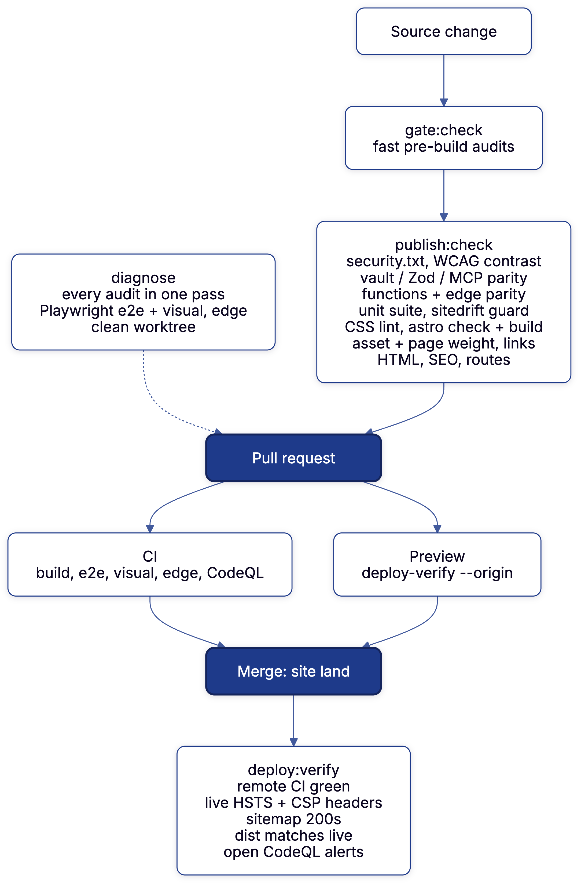

<sup>Diagram source: [`docs/diagrams/gate-ladder.mmd`](../docs/diagrams/gate-ladder.mmd),
pre-rendered with [`diagram`](https://github.com/joeseverino/tools/blob/main/bin/diagram).</sup>

### The gates

1. **`mise run fast`** (the `checks` aggregate): every static gate, collect-all, side by side. A literal color or an unpinned action fails in seconds.
2. **`mise run check`**: the static gates, then the production build (`node bin/build-static.ts`, the artifact Cloudflare ships), then every `built:*` gate on it. CI's `build` job runs exactly this, so the green check proves what a green local run proves. It validates the checkout and never syncs the vault.
3. **`mise run browser`**: builds once with the Turnstile test key and runs the three `browser:*` suites one at a time against it (`PREBUILT=1`), so an 8 GB machine never runs two browsers at once. The CI legs `e2e`, `visual`, and `edge` each run one of those tasks.
4. **`mise run ci`**: `check`, then `browser`; every gate the pipeline runs.

Every gate with what it asserts is the generated [task list](../docs/Commands.md#every-task).

---

## 2. Audits

Each audit's assertion is its task's `description` in the
[task list](../docs/Commands.md#every-task); a failing audit prints its fix. The
detail that does not fit one line is in [§3](#3-testsaudits-audit-detail).

### Other checks

The unit specs, the browser specs, and the checks that run outside the gates.

| Scope | Check | File / command | What it asserts |
| :--- | :--- | :--- | :--- |
| Logic | [content renderer](#the-unit-layer) | `tests/unit/content-render.test.ts` | Every block (`:::figure`, `:::table`, `:::split`, `:::buttons`, `:::button`, `:::center`, `:::hero`), the ` ```terminal ` fence, the placeholders, image modifiers, and standalone-link buttons render to the expected HTML; the guard refuses `import`/`export`, expressions, unlisted tags and attributes, and unsafe URL schemes. |
| Logic | [contact API](#the-unit-layer) | `tests/unit/contact-api.test.ts` | The contact function's validation ladder, honeypot, Turnstile verification (hostname and action included), rate limit, and D1 persistence paths behave, with D1 and siteverify stubbed. |
| Logic | [CSP report API](#the-unit-layer) | `tests/unit/csp-report-api.test.ts` | Both CSP report formats normalize correctly; foreign-document/extension noise is dropped; batches cap at ten; D1 failures return 500. |
| Logic | [CSP policy](#the-unit-layer) | `tests/unit/csp.test.ts` | The policy module builds the build-time hash policy (no nonce, `'unsafe-inline'`, or `'unsafe-eval'`, `report-to` plus the `report-uri` fallback Firefox needs, enforced Trusted Types except on `/contact/`) and the preview proxy's request-time policy (a nonce for the injected bridge script plus a hash per inline script and style). |
| Logic | [content sync](#the-unit-layer) | `tests/unit/content-sync.test.ts` | Reference collection (titles, angle brackets, link definitions, raw `src=`), the path-traversal guard, the writeup chrome strip, image masters (width cap, no metadata, cached), the writer's declared outputs and prune, the document rows, the education join, and a whole sync and `--check` (MDX compile issues included) against a temp vault. |
| Logic | [content contract](#the-unit-layer) | `tests/unit/content-contract.test.ts` | [`contracts/content.v1.json`](../contracts/content.v1.json) drives every consumer: the public projection emits exactly its public fields, the writeup store accepts exactly its editable ones, and `site manage` lists the rest as the contract marks them. |
| Logic | [publish/land orchestration](#the-unit-layer) | `tests/unit/site-orchestration.test.ts` | `site publish` and `site land` against a bare git remote and a stubbed `gh`: a stale checkout is irrelevant, nothing-changed stops, gh failures are fatal, `--dry-run` leaves no branch, and only declared outputs are committed. |
| Logic | [manage TUI](#the-unit-layer) | `tests/unit/site-manage.test.ts` | `site manage` refuses to start without a terminal, and its frames render the featured order, drafts, and gate issues. |
| Logic | [process harness](#the-unit-layer) | `tests/unit/run-harness.test.ts` | The shared runner resolves (never hangs) on non-zero exits, missing binaries, and timeouts. |
| Logic | [task references](#the-unit-layer) | `tests/unit/mise.test.ts` | A `mise run` reference in a doc names a task by its name, an alias, or a glob matching one, and nothing else. |
| Logic | [audit logic](#the-unit-layer) | `tests/unit/check-docs.test.ts`, `tests/unit/check-html.test.ts`, `tests/unit/duplication.test.ts` | The pure halves of the docs, HTML, and duplication audits: path extraction and resolution, directive leaks, clone detection. |
| Docs | [commands/docs parity](#the-unit-layer) | `tests/unit/docs-parity.test.ts` | Every script appears in `docs/Commands.md`, and `docs/Development.md` names every gate aggregate. |
| E2E | [smoke + routing](#smokespects) | `tests/playwright/smoke.spec.ts` | Console stays clean; hero, navigation, and header behave in every engine. |
| E2E | [mobile menu](#menumobilespects) | `tests/playwright/menu.mobile.spec.ts` | Drawer toggles, locks body scroll, closes on Escape and on link nav. |
| E2E | [CSS quality](#css-qualityspects) | `tests/playwright/css-quality.spec.ts` | Skip link, brand tokens, motion durations, reduced-motion, stable click targets, no narrow-viewport overflow. |
| E2E | [contact form](#contactspects) | `tests/playwright/contact.spec.ts` | HTML5 validation, Turnstile-gated error path, and a mocked successful submit + reset. |
| E2E | [portfolio software tab](#portfolio-softwaresinglespects) | `tests/playwright/portfolio-software.single.spec.ts` | The Writeups/Software tab toggle (default, swap, `#software` deep-link, both panels in the DOM), a published package's badge + install line + copy button, the More-projects list, and writeup cross-links. |
| Routes | [routes + 404](#routessinglespects) | `tests/playwright/routes.single.spec.ts` | Every URL in the sitemap returns 200, plus `robots.txt`, `feed.xml`, and unknown-route 404 behavior. |
| Security | [new-tab links](#securitysinglespects) | `tests/playwright/security.single.spec.ts` | Every `target="_blank"` link carries `rel="noopener"`. |
| A11y | [axe sweep](#a11ysinglespects) | `tests/playwright/a11y.single.spec.ts` | Key page archetypes pass the full axe WCAG A/AA ruleset in a real browser. |
| Post-deploy | [deploy verification](#post-deploy-verification) | `bin/deploy-verify.ts` | Remote CI status, live headers and HSTS, live sitemap 200s, hash coverage of the home page's inline script and stylesheet, cache rules, the contact gate, `security.txt` parity, open CodeQL alerts. The response predicates are the edge suite's, from `src/lib/edge-expectations.ts`. |
| CI | CodeQL | default setup, `.github/repo.json` | Semantic JS/TS and workflow scanning for injection, XSS, prototype pollution; the ruleset's code scanning rule holds a merge on a high-severity alert. |
| CI | dependency review | `.github/workflows/dependency-review.yml` | Blocks PRs adding high-severity advisories. |
| CI | OpenSSF Scorecard | `.github/workflows/scorecard.yml` | Supply-chain posture: branch protection, pinned actions, token scope. |

---

## 3. `tests/audits/`: audit detail

The audits whose rules need more than the one line in the [audit table](#2-audits).

### `check-security-txt.ts`
Verifies `public/.well-known/security.txt`:
- It is PGP clear-signed and the signature verifies (`gpg --verify`, GOODSIG/VALIDSIG).
- All RFC 9116 required fields are present (`Contact`, `Encryption`, `Expires`, `Canonical`, `Policy`).
- `Expires` is a parseable future date at least 60 days out, so the monthly `security-txt-expires` run fails, and GitHub emails it, before the file lapses.
- `Canonical` matches the production URL and `Encryption` is a WKD URL whose key file exists under `public/.well-known/openpgpkey/hu/`.

Signing is a separate tool, [`bin/sign-security.ts`](../bin/sign-security.ts) (`mise run sign:security`), because it writes the file and verifiers do not write. Both share the canonical strip/parse logic in [`bin/lib/security-txt.ts`](../bin/lib/security-txt.ts) so the signer and the checker read the signed body the same way.

### `check-contrast.ts`
Expands the ordered [`src/styles/base.css`](../src/styles/base.css) entrypoint, reads its `--color-*` declarations, computes relative luminance for the primary text/background pairings, and asserts each ratio meets WCAG 2.1 AA normal text (>= 4.5:1). New intentional pairs are registered in the `pairs` array.

### `check-no-drafts.ts`
No document under `src/content` carries `published: false`. The committed snapshot is what deploys; `site dev --drafts` writes drafts to the gitignored `.cache/drafts` overlay instead.

### TypeScript type check

`mise run checks:types`: `tsc -p .` then `tsc -p functions`. Every script in the repo is TypeScript that Node runs directly by stripping types, so this is the only place types are checked. The root [`tsconfig.json`](../tsconfig.json) is one strict program over `bin/`, `src/`, `tests/`, and the configs (`noUncheckedIndexedAccess`, `exactOptionalPropertyTypes`, and `erasableSyntaxOnly`, so nothing needs a build step). [`functions/tsconfig.json`](../functions/tsconfig.json) compiles the Pages functions again under the `WebWorker` lib with no Node types; the Cloudflare-runtime globals that lib doesn't know are declared in the `functions/` tree, narrower than `@cloudflare/workers-types`. `astro check` reads [`tsconfig.astro.json`](../tsconfig.astro.json), which narrows the same options to `src/`, for the `.astro` files.

### `check-duplication.ts`

Tokenizes every tracked `.ts` file with the TypeScript scanner (so formatting and comments never matter, and import lines are skipped) and fails on any run of 30 identical tokens spanning 3 or more lines that appears twice; between two test files the bar is 40 tokens over 4 lines, since specs repeat a little setup. The fix is always one shared primitive both sites import. Generated projections (`src/generated/`, `functions/generated/`) and the fixture content are exempt. The scanner is the existing `typescript` dependency.

### `check-functions-parity.ts`

It verifies that the Pages Function
consumes [`contracts/contact.v1.json`](../contracts/contact.v1.json) instead of restating its fields and limits, and that
every handler `INSERT` names only columns the D1 schema defines with matching
bind counts. A persistence mismatch fails before deployment. The API Shield
document, [`contracts/contact.openapi.json`](../contracts/contact.openapi.json),
is regenerated and compared whole by `mise run checks:contracts`.

### `check-sitedrift-preview.ts`
Confirms the sitedrift review wrapper is injected when `CF_PAGES_BRANCH !== 'main'` and that production builds (`main`) ship as untampered Astro pages with `/__sitedrift` returning 404.

### `check-css.ts`
Scans `src/styles/**/*.css` for `--variable: …` declarations, collects `var(--variable)` usages from the stylesheets and from every `.astro` and `.ts` file under `src/` (a token consumed only in a template or script still counts), and fails listing any custom property that is defined but never consumed.

### `check-assets.ts`
Runs after the build over every image in the outDir, committed under `public/assets/` or encoded from content: any at or over 1.5 MB fails, listed largest first. The `ok` line carries the image count and total weight.

### `check-repository-policy.ts`
Structural health:
- **Node version**: the `node` pin in [`mise.toml`](../mise.toml) equals [`.nvmrc`](../.nvmrc), the running Node matches it on major.minor (patch drift is allowed, so a Node security patch doesn't block the gates); `engines.node` and the exact `packageManager` npm pin agree with it.
- **Clean tree**: no committed `.env` / `.dev.vars`, no `dist/` or `playwright-report/`.
- **Stylesheets**: component styles live in `src/styles` modules.
- **No client-side HTML sinks** (`innerHTML` and kin) and no Astro View Transition hooks.
- **Public sources** (`src/content`, `src/pages`, `src/components`) carry no private-link markers or internal hostnames.
- **Workflows**, read as YAML: no job's `runs-on` or matrix `os` is a floating `-latest` label, and every job that runs steps sets `timeout-minutes`.
- **TypeScript only**: no tracked `.js`/`.mjs`/`.cjs`.
- **No explicit `any`**: an `any` type anywhere in the TypeScript syntax tree of a `.ts` file, or of an `.astro` file's frontmatter and `<script>` elements, fails; `unknown` and narrowing say what the code knows.
- **No unexplained suppressions**: no `@ts-ignore` or `@ts-nocheck` comment in those same sources; `@ts-expect-error` must carry a reason.

What a maintained tool checks is left to it: `npm ci` refuses a lockfile out of step with `package.json`; stylelint (`checks:css-lint`) refuses a literal color (`color-no-hex`, `color-named`, and `rgb`/`hsl` in `function-disallowed-list`) everywhere except the generated token blocks, which `mise run sync:tokens` fences with `stylelint-disable` comments for exactly the rules their values trip; and zizmor (`checks:workflows`) refuses an action not pinned to a commit SHA, with the findings it accepts listed with a reason in [`.github/zizmor.yml`](../.github/zizmor.yml).

### Links: `checks:doc-links` and `built:links`
[lychee](https://lychee.cli.rs), pinned in `mise.toml`, run offline with fragment checking. Settings shared with the external link check live in [`lychee.toml`](../lychee.toml).
- `checks:doc-links` reads the tracked engineering docs (the `docs` pathspecs in `mise.toml`: `README.md`, `SECURITY.md`, `CONTRIBUTING.md`, `docs/**`, `tests/*.md`): every relative link and image resolves, and a `#fragment` names a heading slugged as GitHub does, or an explicit `id`. Fenced and inline code are example syntax and skipped.
- `built:links` runs after the build over everything in `dist/`: every `href`, `src`, and `srcset` candidate, root-relative or `https://jseverino.com/` (the canonical link), resolves to an emitted file, a directory link to its `index.html`, and its `#fragment` to an `id` on that page. The Function routes and `/cdn-cgi/` have no file and are excluded in `lychee.toml`. `og:image` is a `<meta content>` value, which lychee does not extract.

### `check-docs.ts`
What no link checker knows, over the same tracked docs (gitignored local files such as `AGENTS.md` are never read):
- every `mise run <task>` reference names a task, and no `npm run` names anything but `build`, the one npm script (every other command is a mise task),
- every backticked repo path resolves. A token in inline code is a repo path when its first segment is a top-level entry (`bin/site.ts`, `docs/`, `dist/`); it resolves when `git ls-files` tracks it or a file under it, or when `git check-ignore` reports it ignored (generated output such as `dist/` and `.cache/`). A placeholder (`tests/audits/<name>.ts`, `src/styles/**/*.css`) is checked up to the directory before it. Intentional example paths go in `EXAMPLE_PATHS` in the audit.

Paths inside fenced code blocks are example syntax and skipped; script and task references are validated everywhere, including command blocks. Site content under `src/content` is out of scope (it links to live routes and external URLs, which the weekly link check covers).

### `check-page-weight.ts`
Runs after the build, as the deterministic complement to the CI Lighthouse run. Three byte budgets over the emitted output: per-page HTML (150 KB), CSS (75 KB: the stylesheet every page inlines, plus any external `.css`), and total JS (25 KB), set from the measured baseline (~115 KB worst page carrying the ~36 KB inlined stylesheet, ~5 KB JS) with headroom. A failure means a page, the stylesheet, or the scripts grew past budget. Raising a budget is a commit to `tests/audits/check-page-weight.ts`.

### `built:html`
Runs after the build. Structural assertions over every emitted page, statically. [html-validate](https://html-validate.org), configured in [`.htmlvalidate.json`](../.htmlvalidate.json) with only these rules: `no-dup-id` (duplicate ids silently break fragment links, label association, and `aria-*` references), `wcag/h37` (every `` carries an `alt` attribute; empty `alt` is valid and marks a decorative image, a missing attribute is always an authoring bug), and `heading-level` (a page opens at its one `h1` and never skips a level going down; an `h3` straight under the `h1` hides the structure assistive technology navigates by). Then `check-html.ts` asserts no literal `::name` directive reaches the page text, which no rule covers. A leaked directive is a typo (`::termnial`) or a directive the page's renderer does not support; text inside `<pre>`, `<code>`, `<script>`, `<style>`, and comments is ignored, and `a::b` or `::1` never counts. The all-pages static complement to the browser-side [axe sweep](#a11ysinglespects), which runs deeper rules on fewer pages.

### `check-routes.ts`
Runs after the build. [`public/_routes.json`](../public/_routes.json) includes only the Function routes (`/api/*` and `/__sitedrift/*`) with an empty exclude list, so every HTML page and asset is a plain static file that never invokes a Function and never spends the daily Functions quota (100,000 requests, now spent only by the contact form, CSP reports, and the preview proxy). The CSP is written into the built `_headers`, not issued per request. The audit maps every emitted `.html` file to the URLs Pages serves it at and every file in `functions/` to its route, and fails if any built page would invoke a Function, if a Function route would not, if the file breaks the Pages limits (100 rules, 100 characters each), or if the built `_headers` is incomplete. The edge suite proves the same routing under `wrangler pages dev`.

### `check-seo.ts`
Runs after the build, over the emitted HTML in the outDir (`dist`). Every rendered page must carry a non-empty `<title>`, a canonical link, `og:title`, `og:image`, and only valid JSON-LD. Redirect stubs (`Astro.redirect`, detected by their `meta http-equiv="refresh"`) are skipped, since they are not indexable content. It also fails on zero pages, since an empty or stale outDir is a broken build.

### The unit layer

A third pre-build layer beside the audits and browser specs: `node:test` suites under [`tests/unit/`](./unit/) that exercise pure logic directly: input in, output out, no browser and no build. The [other checks](#other-checks) table lists every spec; the main surfaces:

- **The content renderer** ([`content-render.test.ts`](./unit/content-render.test.ts)), described below.
- **The Cloudflare Pages functions**, the production code that otherwise first runs on Cloudflare. [`contact-api.test.ts`](./unit/contact-api.test.ts) drives the full contact ladder (content-type/size/JSON validation, honeypot, field limits, Turnstile verification, the per-IP rate limit, D1 persistence and failure) with D1 and the siteverify call stubbed. [`csp-report-api.test.ts`](./unit/csp-report-api.test.ts) covers both report formats, the noise filters (foreign documents, browser extensions, extension-injected inline violations), batch capping, and D1 failure. `csp.test.ts` verifies the policy module: the build-time hash policy and the preview proxy's request-time nonce and hash policy.
- **The process harness** ([`run-harness.test.ts`](./unit/run-harness.test.ts)): the failure modes a green run never exercises (non-zero exits, missing binaries, and hung commands must all resolve as failed results, never hang a caller).
- **The audits' pure logic** ([`check-docs.test.ts`](./unit/check-docs.test.ts), [`check-html.test.ts`](./unit/check-html.test.ts), [`duplication.test.ts`](./unit/duplication.test.ts)): each audit exports its rule and runs only under `import.meta.main`, so the rule is tested without a repo or a build.
- **Task references** ([`mise.test.ts`](./unit/mise.test.ts)): how `checks:docs` decides that a `mise run` reference names a task.
- **Commands/docs parity** ([`docs-parity.test.ts`](./unit/docs-parity.test.ts)): every script in [`docs/Commands.md`](../docs/Commands.md), every gate aggregate in [`docs/Development.md`](../docs/Development.md).

[`tests/unit/content-render.test.ts`](./unit/content-render.test.ts) compiles Markdown with Sätteri and the site's plugins from [`src/lib/markdown/`](../src/lib/markdown/), the same options Astro's processor gets. The guard cases compile as MDX, the format content ships in, and assert the refusal.

Runs on Node's test runner via type stripping, with no extra dependency. Its reporter, [`quiet-reporter.ts`](./unit/helpers/quiet-reporter.ts), prints one line on a pass and hands a failing run to Node's own spec reporter, so every failure prints in full:

```sh
mise run checks:unit
```

Each case pairs a markdown input with the HTML it must produce, so a processor upgrade either keeps the block grammar or fails.

---

## 4. `tests/playwright/`: browser specs

The browser suite runs against the compiled static output (`dist/`) served by the preview server, never Astro's dev server. Config lives in [`tests/playwright.config.ts`](./playwright.config.ts); routing is by filename suffix, so every spec's project matrix is set by its name: `*.mobile.spec.ts` runs on the mobile device projects, everything else on the desktop projects. Specs named `*.single.spec.ts` are engine-independent (route responses, file resolution, link attributes) and run only on `chromium-desktop` instead of the full matrix (one run, not six).

The functional specs do not pin writeup slugs. [`helpers/writeups.ts`](./playwright/helpers/writeups.ts) resolves URLs from the synced content snapshot by capability (for example, the writeup with a table or the most images), so renaming a writeup in the vault cannot break the code gates. The visual suite is separate: it never renders real content. It builds the synthetic tree in [`fixtures/content/`](./fixtures/content/) and pins the fixture slugs, so a publish cannot move a baseline.

### `smoke.spec.ts`
- **Console health**: fails on browser console errors during navigation (with narrow allowances for preconnect noise).
- **Interactivity**: hero renders, header shadow toggles on scroll, primary links resolve.

Sitemap route health lives in `routes.single.spec.ts`.

### `menu.mobile.spec.ts`
- **Overlay logic**: the popover toggles open/closed, locks body overflow, and closes on `Escape`, on link navigation, or on a backdrop click.
- **Tap highlights**: touch targets suppress the title-only tap highlight on WebKit/Blink.

### `css-quality.spec.ts`
- **Accessibility**: the skip link focuses and becomes visible; forced-colors (high-contrast) outlines render.
- **Theme integrity**: brand token application, standard motion duration, and reduced-motion media queries that drop transitions to `0s`.
- **Interaction stability**: button/card click targets don't layout-shift between hover, press, and release.
- **Containment**: tables don't overflow a 320px viewport; images fill their boxes with `object-fit: cover`.

```ts
test('focus exposes the skip link', async ({ page }) => {
  await page.goto('/');
  const skipLink = page.locator('.skip-link');
  await skipLink.focus();
  await expect(skipLink).toBeFocused();
  await expect(skipLink).toBeVisible();
  await expect(skipLink).toHaveCSS('outline-style', 'solid');
});
```

```ts
test('buttons and cards keep a stable click target through press and release', async ({ page }) => {
  await page.goto('/404.html');
  const button = page.getByRole('link', { name: 'View Portfolio' });
  const buttonBox = await button.boundingBox();
  expect(buttonBox).not.toBeNull();

  await page.mouse.move(buttonBox!.x + buttonBox!.width / 2, buttonBox!.y + buttonBox!.height / 2);
  await expect(button).toHaveCSS('translate', '0px -1px'); // hover raises the button

  const raisedButtonBox = await button.boundingBox();
  await page.mouse.down();
  expect(await button.boundingBox()).toEqual(raisedButtonBox); // press must not shift it
  await page.mouse.up();
});
```

### `contact.spec.ts`
Drives the contact form with Cloudflare Turnstile in test-key mode (`PUBLIC_TURNSTILE_SITE_KEY=1x00000000000000000000AA`, set in `tests/playwright.config.ts`). The `beforeEach` aborts the Turnstile script (`challenges.cloudflare.com`) so its always-pass test key cannot auto-solve mid-test; each test then controls the token state deterministically instead of racing the widget. Three paths: HTML5 required-field validation, the error shown when no token is present, and a fully mocked successful submit. The success case intercepts `POST /api/contact`, asserts the payload, and overrides `FormData.prototype.get` so the form reads a stubbed Turnstile token even though no real challenge ran:

```ts
test('submits successfully with simulated turnstile and mocked api', async ({ page }) => {
  await page.route('/api/contact', async (route) => {
    const payload = route.request().postDataJSON();
    expect(payload.name).toBe('Jane Doe');
    expect(payload.turnstileToken).toBe('mocked-turnstile-token');
    await route.fulfill({ status: 200, contentType: 'application/json', body: JSON.stringify({ ok: true }) });
  });

  await page.locator('#contact-name').fill('Jane Doe');
  await page.locator('#contact-email').fill('jane@example.com');
  await page.locator('#contact-message').fill('Mocked message content');

  // Stub the Turnstile token the form reads off the FormData on submit.
  await page.evaluate(() => {
    const originalGet = FormData.prototype.get;
    FormData.prototype.get = function (name) {
      if (name === 'cf-turnstile-response') return 'mocked-turnstile-token';
      return originalGet.call(this, name);
    };
  });

  await page.locator('.contact-submit').click();

  const status = page.locator('.contact-status');
  await expect(status).toHaveAttribute('data-kind', 'success');
  await expect(status).toContainText('Thanks, your message has been sent');
  await expect(page.locator('#contact-name')).toHaveValue('');
});
```

### `a11y.single.spec.ts`
Runs axe-core's full WCAG A/AA ruleset (`wcag2a`, `wcag2aa`, `wcag21a`, `wcag21aa`) against the key page archetypes: home, the portfolio listing, a writeup (resolved via `helpers/writeups.ts`), the contact form, and the resume. Label association, landmark structure, and computed color contrast resolve here; the static audits cover the cheaper structural rules on every page. Failures print the rule id, impact, and an offending node.

### `routes.single.spec.ts`
Route-level responses, engine-independent so chromium only: every URL in the sitemap index returns 200 (request-only, no page render); `robots.txt` (200, plain text, contains the `Sitemap:` line), `feed.xml` (200, XML, valid RSS with at least one `<item>`), and an unknown route (returns a real `404` status and renders the not-found page).

### `security.single.spec.ts`
Asserts every `target="_blank"` link across the key pages carries `rel="noopener"`, so an opened tab cannot reach back through `window.opener`.

### `portfolio-software.single.spec.ts`
Covers the Software tab of `/portfolio`. Asserts the tab toggle behaviour: defaults to Writeups, swaps panels on click while updating `aria-selected` and the `#software` hash, deep-links straight to Software via the hash, and keeps both panels in the DOM (so the content is present without JS and for crawlers). Then checks the derived content renders: a published package's registry badge, install line, and copy button; the "More projects" compact list; and that a software writeup cross-link resolves to a real writeup page. Engine-independent DOM, so it runs `chromium-desktop` only (`.single`).

### Running the suite

```sh
mise run browser:e2e                 # functional specs across Chromium, Firefox, WebKit
mise run browser:e2e --ui              # interactive Playwright runner
mise run browser:visual          # visual regression (macOS Chromium)
mise run browser:visual --update-snapshots   # re-baseline after an intentional design change
```

The HTML report after a full run:

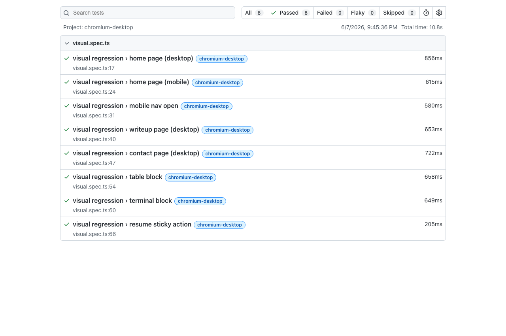

---

## 5. Visual regression

`visual.spec.ts` captures whole-page and element-level screenshots and diffs them against committed baselines. To avoid cross-platform font and rasterization noise, baselines are owned by Chromium on macOS. It runs under [`tests/playwright.visual.config.ts`](./playwright.visual.config.ts), which builds [`fixtures/content/`](./fixtures/content/) (four synthetic writeups with a fixed featured order, a shared tag, a table, a terminal block, and a figure; the pages the build renders; a fixed GitHub snapshot; committed fixture images) into `dist-visual/` with `SITE_CONTENT_ROOT` set. That build is hermetic (no GitHub or package-registry calls), so a baseline moves only when a layout or a fixture does; real content stays covered by the functional suite and the build audits. Retries are off, and readiness is deterministic (fonts and eager images settled, overlays polled to full opacity) not `networkidle` or sleeps. Failed runs write `expected`, `actual`, and `diff` images to `test-results/visual/`; CI uploads them with the HTML report.

The committed PNGs under [`playwright/visual.spec.ts-snapshots/`](./playwright/visual.spec.ts-snapshots/) are review artifacts: check them in the diff before any visual change merges.

### What each baseline protects

| Baseline | Protects |
| :--- | :--- |
| Home (desktop / mobile) | Hero, header, primary CTAs, above-the-fold spacing; mobile narrow layout independently. |
| Mobile nav open | Overlay, close control, link spacing, body lock, viewport coverage. |
| Writeup (desktop) | Article typography, metadata, hero treatment, reading width, sticky action. |
| Contact (desktop) | Form layout, field spacing, labels, copy, submit control. |
| Table / terminal block | High-risk authored blocks isolated so a page change can't hide block regressions. |
| Resume action | The fixed, centered resume action relative to page content. |
| Portfolio Software (desktop / mobile) | Full-page Software tab: featured cards, install lines, the More-projects list, and mobile stacking. Live versions, downloads, and dates are masked so the baseline pins layout, not numbers. |

### Committed baselines

**Home, desktop and mobile**

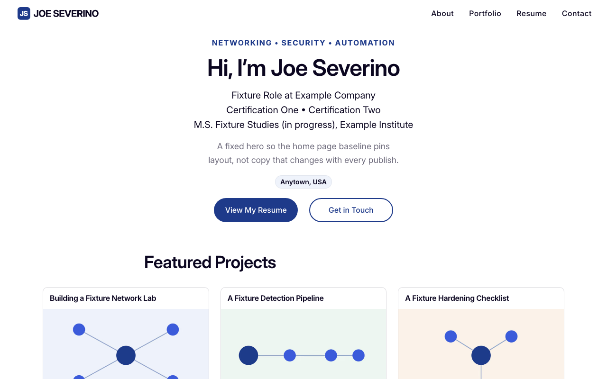

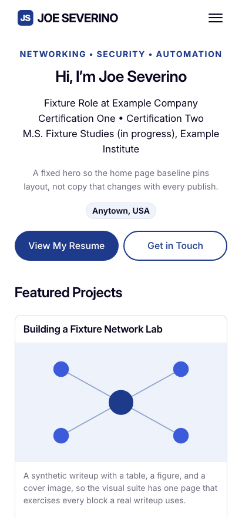

**Mobile navigation open**


**Portfolio writeup** and **contact**

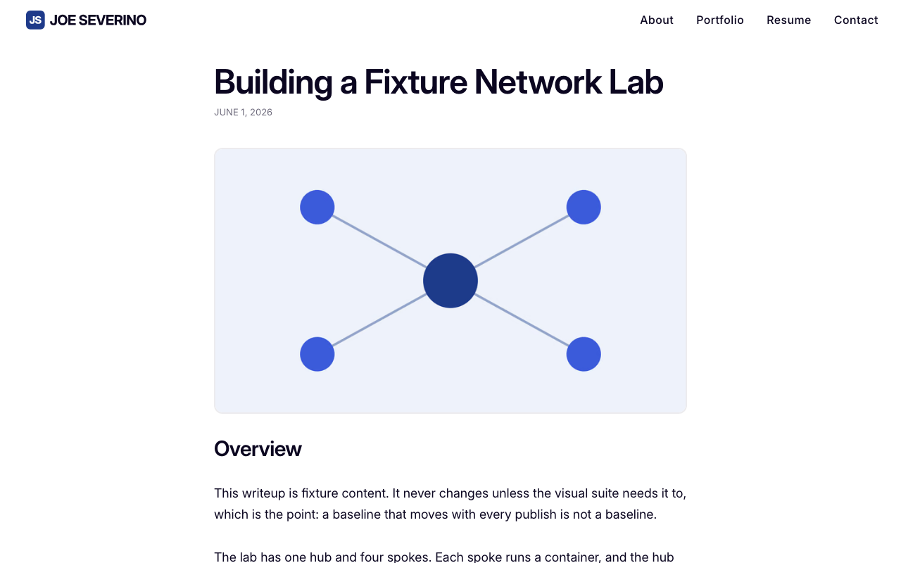

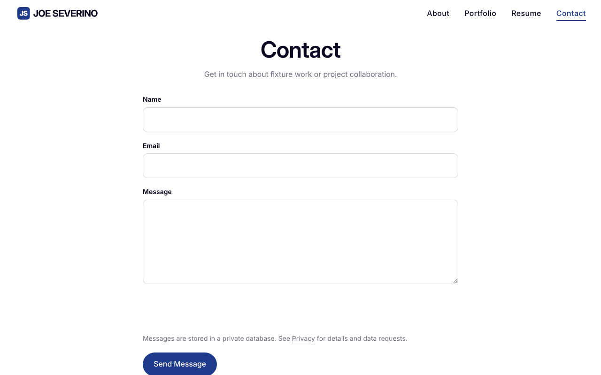

**Structured content**

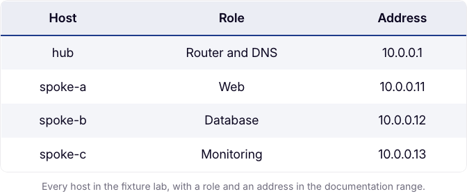

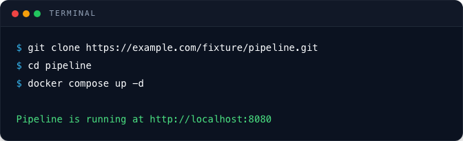

**Resume action**

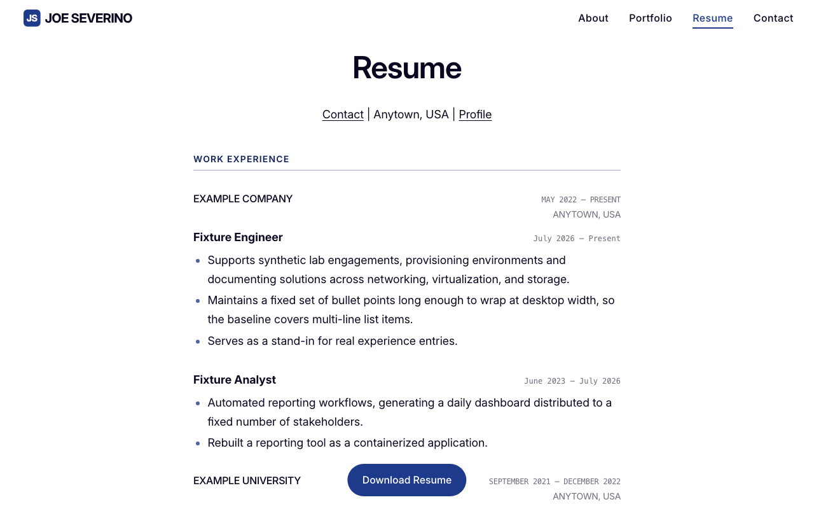

**Portfolio Software tab, desktop and mobile**

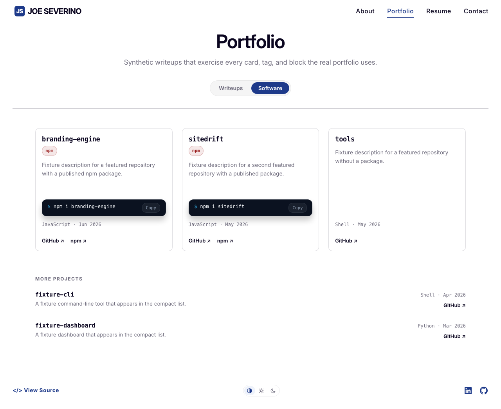

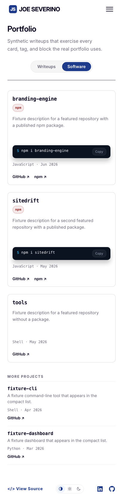

### Diff example: header height shift
Triggered by changing the header height (e.g. `3.6rem` → `8rem`), pushing the whole layout down:

| Expected | Actual | Diff |
| :---: | :---: | :---: |
| 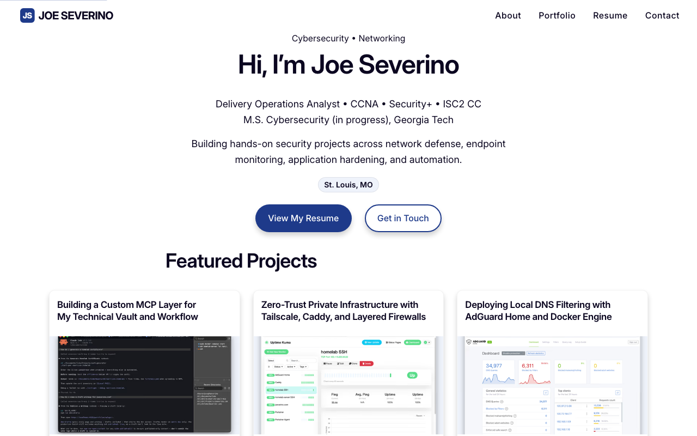 | 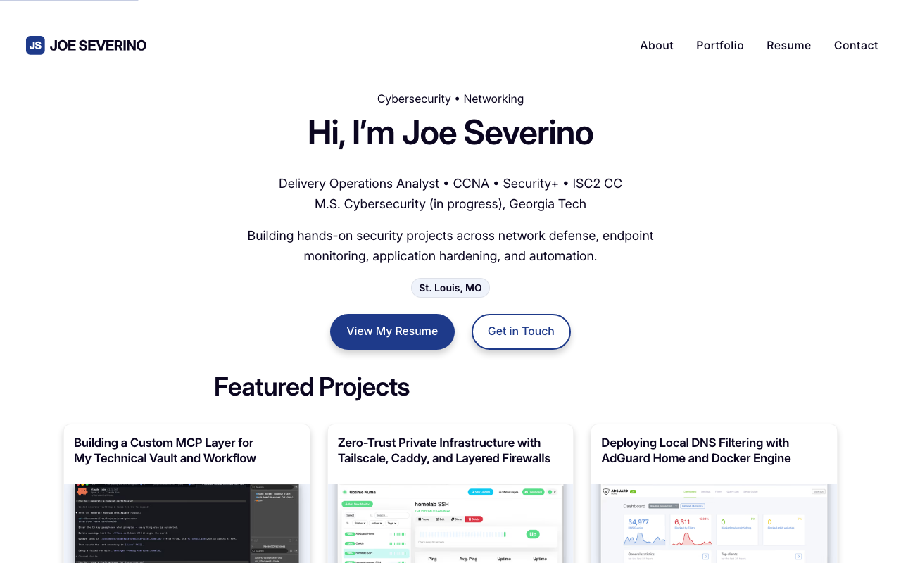 | 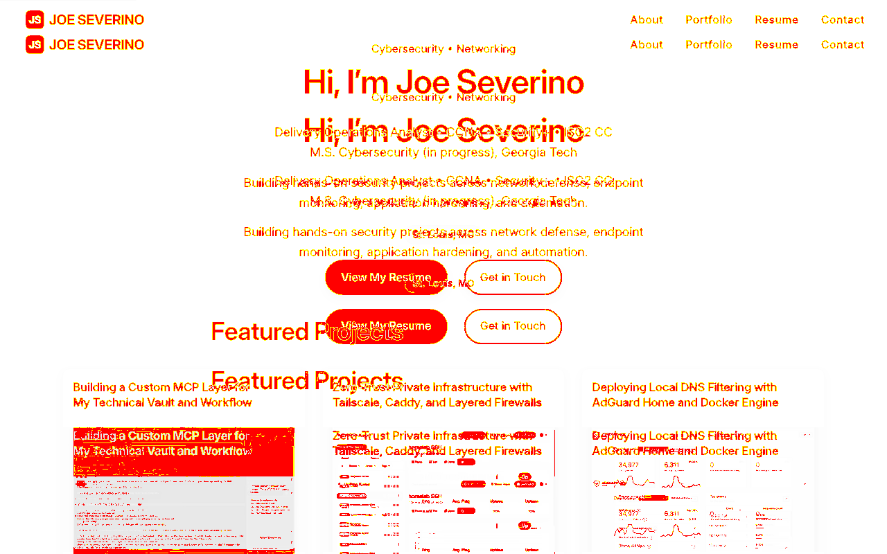 |

### Diff example: terminal block color shift
Triggered by changing the terminal block background (`#0b1220` → `#3b82f6`):

| Expected | Actual | Diff |
| :---: | :---: | :---: |
| 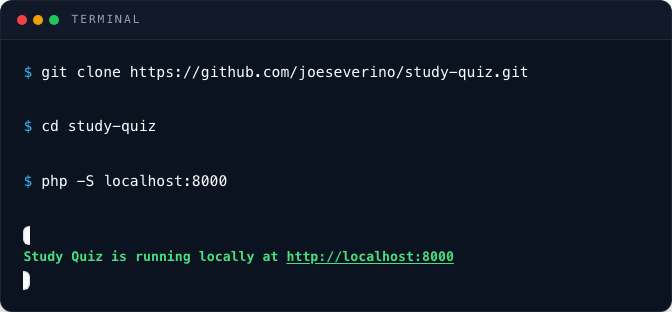 | 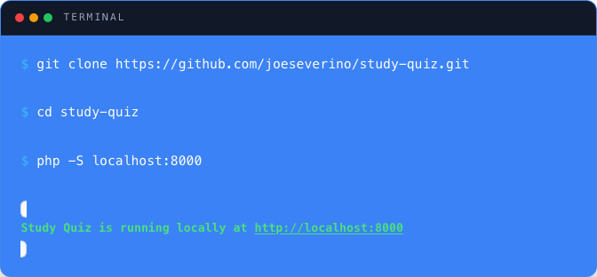 | 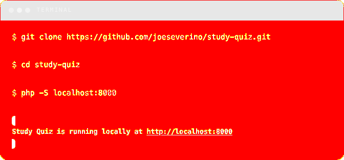 |

### Functional failure capture
When a functional assertion fails, Playwright screenshots the page at the moment of failure. Below: the contact form's error state when submitted without solving Turnstile.

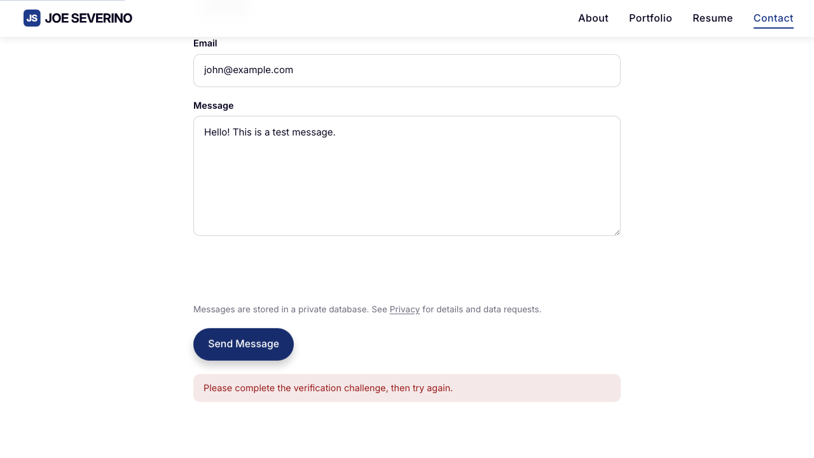

---

## 6. Edge runtime and post-deploy verification

### The edge runtime suite (`tests/edge/`)

`astro preview` serves static files only. The Pages Functions
and the served [`public/_headers`](../public/_headers) rules (carrying the CSP that
`bin/build-csp.ts` writes at build time) exist only on Cloudflare's
runtime, so the browser suite cannot see them. The edge suite serves the built
output through `wrangler pages dev` (Cloudflare's `workerd`, bundled with the
`wrangler` devDependency; no account or token involved) and asserts the served
responses. Config lives in [`tests/playwright.edge.config.ts`](./playwright.edge.config.ts);
the port and the compatibility date live in
[`browser-test-env.ts`](./browser-test-env.ts), and the date must match the
Pages project's runtime setting. The specs use Playwright's request fixture
only, so no browser is launched.

[`runtime.spec.ts`](./edge/runtime.spec.ts) asserts, against `/` and one writeup
page picked from the build rather than a pinned slug:

- the CSP carries `default-src 'none'`, `object-src 'none'`, `base-uri 'self'`, `frame-ancestors 'self'`, and `report-to csp-endpoint` with the `report-uri` fallback; it has no nonce, `'unsafe-inline'`, `'unsafe-eval'`, `'strict-dynamic'`, or `blob:`, Trusted Types is enforced except on `/contact/` where it is report-only (that path's own rule detaches the global policy), and `Reporting-Endpoints` is present. The predicates live in [`src/lib/edge-expectations.ts`](../src/lib/edge-expectations.ts), shared with `deploy:verify`;
- every inline script and style is covered by a hash in the policy, and the policy is identical on every request;
- the static security headers from `public/_headers` are present and no CORS header leaks onto HTML;
- fingerprinted `/_astro/` assets are `immutable` for a year while chrome assets under `/assets/icons/` are short-lived and never immutable;
- an unknown route returns the root `404.html` under the same policy, and the sitedrift review proxy is absent from a production build;
- `POST /api/contact` refuses a submission without a Turnstile token, a non-JSON body (`415`), malformed JSON, and fields outside the contract, all before Turnstile or D1 are touched;
- `security.txt` is served byte-for-byte from the committed, signed file, and the WKD key is served as `application/octet-stream`.

```sh
mise run browser:edge    # build, serve through wrangler pages dev, run the suite
mise run serve:edge       # the same runtime on http://127.0.0.1:8788, for checks by hand
```

CI runs this as the `edge` leg of the `playwright` matrix; locally it is part of
`mise run browser`.

### Post-deploy verification

`bin/deploy-verify.ts` (`mise run deploy:verify`) runs after a deploy to production, from a residential IP, and confirms the live deploy matches the local gate. Against `jseverino.com` it is not run from CI, because Cloudflare Bot Fight Mode challenges GitHub-hosted runners. The `deploy` workflow instead runs `deploy-verify --origin <url>` against each deployment's own `*.pages.dev` URL, which is outside the zone: the response checks below minus the repo state, remote checks, code scanning, and HSTS (zone-level). `--preview` skips the sitedrift guard and the page-markup checks (inline hash coverage, cache rules) on branch previews, where sitedrift wraps every HTML route; `--slug <writeup>` checks one writeup after a publish (listed, served with headers, images resolve).

1. **Repo state**: local branch is `main`, clean, fully pushed.
2. **Remote checks**: polls the GitHub API until `build`, `e2e`, `visual`, `edge`, and Cloudflare Pages report success.
3. **Live response audit** against `https://jseverino.com/` and one deep writeup page (picked from the live sitemap, not a pinned slug, so renaming a writeup can't break verification):
   - HSTS present with `includeSubDomains`,
   - CSP active with no `'unsafe-inline'` script source and the home page's inline script and stylesheet covered by its hashes (`inline`),
   - `reporting-endpoints` and `report-to` routed to `/api/csp-report`, Trusted Types enforced with report-only on `/contact/`,
   - sitedrift proxy paths return `404`.
4. **Live sitemap traversal**: HEAD every route from `sitemap-index.xml`; zero dead links.
5. **Dist branch**: every sitemap page matches the `dist` branch byte for byte, at a verified commit (retried for six minutes while the publish catches up; see [Dist Branch](../docs/Dist-Branch.md)).
6. **CodeQL**: no open scanning alerts.

---

## 7. Remote CI/CD workflows

Each workflow, its trigger and what it verifies are in the
[continuous integration table](../docs/Development.md#continuous-integration).

---

## 8. Troubleshooting

A failing audit prints its own fix; `mise run <gate>` reruns that one gate. Two failures need more than a line:

### Visual mismatch
If unintended, fix the layout/CSS. If it's an approved redesign:
1. `mise run browser:visual --update-snapshots` on macOS,
2. inspect the image diff under `tests/playwright/visual.spec.ts-snapshots/` to confirm only the expected pixels changed,
3. commit the updated baselines with the styling change.

### Unpinned GitHub Action
`checks:workflows` (zizmor `unpinned-uses`) reports a tag (`@v4`) where a SHA belongs. Replace it with the commit SHA for that release, e.g. `uses: actions/checkout@11bd71901bbe5b1630ceea73d27597364c9af683 # v4.2.2`.
