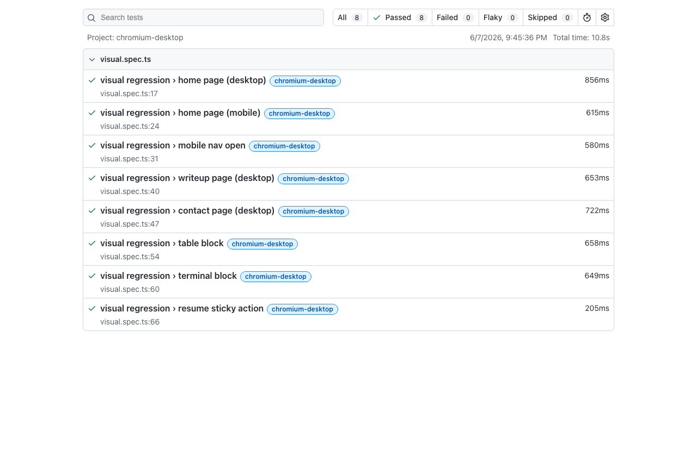
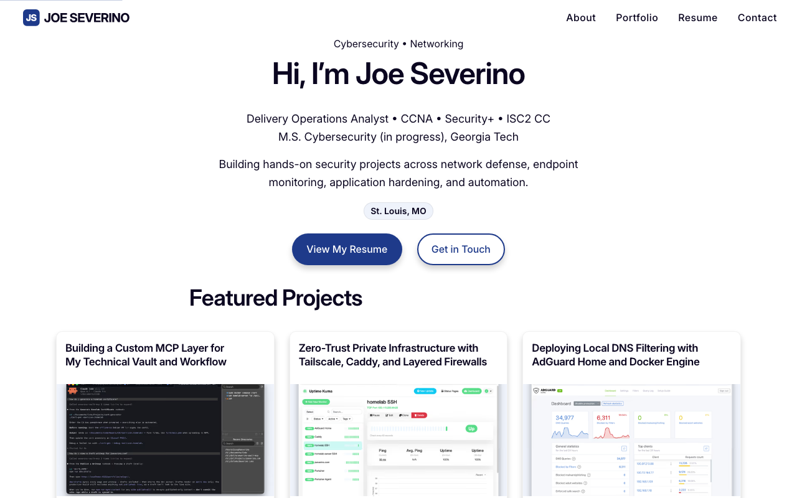
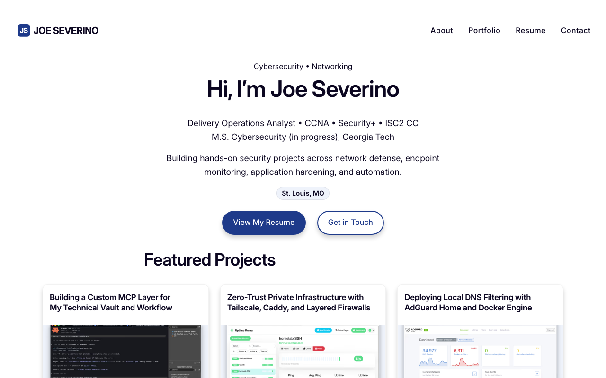
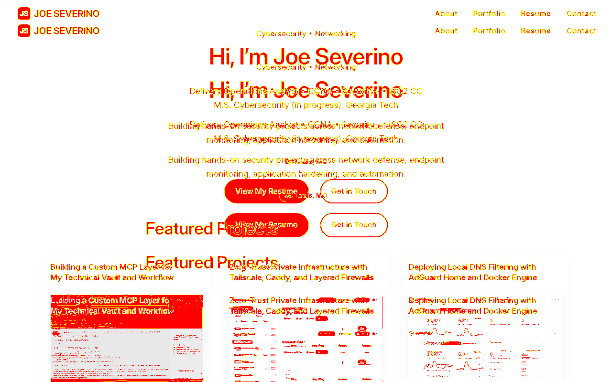
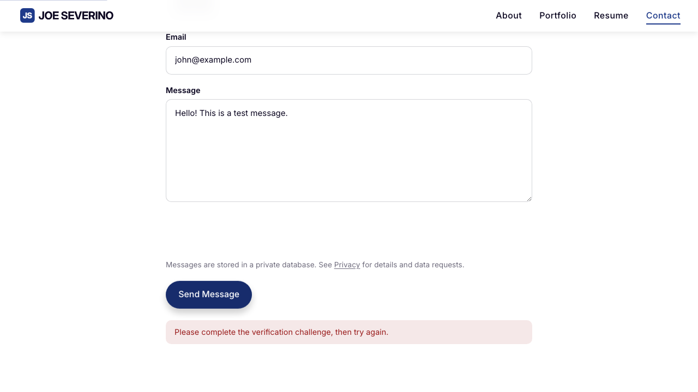

# Tests and validation

Every change passes five layers: Node audits that assert invariants about the
source and the build, unit tests, Playwright specs that drive the **built**
output in a browser, request specs against it in the Cloudflare runtime, and
post-deploy probes against each deployment. This directory holds the first
four; the task files under [`mise-tasks/`](../mise-tasks/) name each one a
gate, and the aggregates in [`mise.toml`](../mise.toml) sequence them.

> This file is the tour. The map of every spec and audit, with the gate that
> runs it and the rules they share, is **[ARCHITECTURE.md](./ARCHITECTURE.md)**.

```
tests/
├── audits/        Node checks: assert an invariant, exit non-zero with the fix on failure
├── unit/          node:test specs for the code and for single repository files, no build or browser
├── edge/          request specs against the build served by astro preview (API routes, _headers, built policy)
├── playwright/    browser specs against the build served by astro preview
└── fixtures/      the synthetic content the visual suite builds
```

Each check is a mise task named `<job>:<gate>` (`checks:*` before the build,
`built:*` on it, `browser:*` in a browser), and each aggregate runs its job by
glob, so a new task runs locally and in CI with no second list to edit.

## How it fits together

The [validation flow](../docs/Development.md#gates) traces a change from the
local gates through the pull request's CI and preview to production.

| Gate | Runs | Covers |
| :--- | :--- | :--- |
| `mise run fast` | local | the static gates: duplication, types, repository policy, docs, CSS lint, unit tests, `astro check`, the draft guard |
| `mise run check` | local and CI (`build`) | the static gates, the production build, then page and image weight, internal links, structural HTML, the built headers, and SEO |
| `mise run browser` | local and CI (`e2e`, `visual`, `edge`) | one build, then the cross-browser, visual, and edge runtime suites, one at a time |
| `mise run deploy:verify` | after a deploy | live headers and CSP hash coverage of inline code, sitemap 200s, a real 404, the contact gate, `security.txt` parity; on production also remote CI status and open CodeQL alerts |

`mise tasks --hidden` lists every gate with what it asserts.
`mise run ci` runs `check` and then `browser`: every gate the pipeline runs.
Each phase keeps going past a failure and ends on the gates that failed; each
failing gate prints its own fix.

## The layers

[The layer map](./ARCHITECTURE.md#the-layers) says what each directory runs
against, and [its table](./ARCHITECTURE.md#every-spec-and-audit) what each spec
and audit proves. The [routes suite](./playwright/routes.single.spec.ts) and the
[responsive layout suite](./playwright/responsive-layout.single.spec.ts) read
every page from the sitemap, so a new writeup is covered with no test to add.
The visual suite renders the fixture content only, so a publish never moves a
baseline.

## What it catches

A full Playwright run, reported:



Visual regression pins page and component screenshots to macOS Chromium baselines.
A stray header-height change, for example, is caught as a pixel diff before it can
merge:

| Expected | Actual | Diff |
| :---: | :---: | :---: |
|  |  |  |

Functional failures screenshot the page at the moment of the failed assertion,
here the contact form submitted without solving Turnstile:



Every baseline is under [`visual.spec.ts-snapshots/`](./playwright/visual.spec.ts-snapshots/).

## Writing a test

A test's name is the behavior it holds, written as a sentence: what is true,
with no subject prefix and no "should". A name never holds a value computed when
the file loads (a time, a random path): each Playwright worker loads the file
again, and a name that differs between them fails the run as a test not found. A `describe` groups tests only where a
file holds more than one subject; it never wraps a whole file. Each behavior is
tested once, and setup two files share lives in `unit/helpers/` or
`playwright/helpers/`.

A test that holds one repository file to a rule (a workflow's permissions,
`repo.json`, the mise config) lives in `unit/` beside the logic tests: it reads
files and needs no build or browser, so `checks:unit` runs it in the fast gate.
An audit in `audits/` is its own gate, for a rule over every file or over the
build, and prints the fix for each failure.

## Run it

```sh
mise tasks                                   # every task with what it asserts or does

mise run fast                                # the static gates, collect-all
mise run check                               # + the build and every gate on it
mise run ci                                  # + the browser suites

mise run checks:unit                         # unit suite (fast, no browser)
mise run checks:unit tests/unit/json.test.ts # one spec, under the pinned Node
mise run browser:edge                        # the edge runtime suite
mise run browser:e2e                         # functional specs across Chromium, Firefox, WebKit
mise run browser:visual                      # visual regression (macOS Chromium)
mise run browser:visual --update-snapshots   # re-baseline after an intentional design change
mise run dev:look all                        # see every page at each width and scheme; fails on sideways scroll
```

---

The map: [ARCHITECTURE.md](./ARCHITECTURE.md), with every spec and audit, the
gate that runs it, and the rules they share.
